# ANALISIS LENGKAP SISTEM LMS CENDEKIA
## DIAGRAM KONTEKS (DCD), DFD LEVEL 0, DAN DFD LEVEL 1 (DIPISAH PER SUB-PROSES)

Dokumen ini berisi pemodelan sistem informasi **LMS Cendekia**. Setiap proses dan sub-proses (1.1, 1.2, sampai 6.4) **dipisah menjadi diagram Mermaid tersendiri yang berdiri sendiri di bagian atas, kemudian diikuti dengan penjelasan alur yang mudah dipahami di bagian bawahnya**.

Dengan pemisahan ini, setiap diagram di **draw.io** (*diagrams.net*) menjadi sangat bersih, tidak ada garis ruwet bersilangan, dan sangat mudah dibaca.

---

## DAFTAR ISI
1. [Bagian 1: Ringkasan Sistem Cendekia](#bagian-1-ringkasan-sistem-cendekia)
2. [Bagian 2: Diagram Konteks (DCD / Level 0)](#bagian-2-diagram-konteks-dcd--level-0)
3. [Bagian 3: DFD Level 0 (6 Proses Utama)](#bagian-3-dfd-level-0-6-proses-utama)
4. [Bagian 4: DFD Level 1 (Dipisah per Sub-Proses 1.1 s/d 6.4)](#bagian-4-dfd-level-1-dipisah-per-sub-proses)
   - [4.1 Proses 1.0: Login & Kelola Akun Pengguna](#41-proses-10-login--kelola-akun-pengguna)
     - [4.1.1 Sub-proses 1.1: Login & Cek Hak Akses](#411-sub-proses-11-login--cek-hak-akses-akun)
     - [4.1.2 Sub-proses 1.2: Ubah Profil & Kata Sandi](#412-sub-proses-12-ubah-profil--kata-sandi)
     - [4.1.3 Sub-proses 1.3: Kelola Akun Dosen & Mahasiswa](#413-sub-proses-13-kelola-akun-dosen--mahasiswa)
   - [4.2 Proses 2.0: Kelola Data Jurusan & Mata Kuliah](#42-proses-20-kelola-data-jurusan--mata-kuliah)
     - [4.2.1 Sub-proses 2.1: Kelola Data Fakultas & Jurusan/Prodi](#421-sub-proses-21-kelola-data-fakultas--jurusan--prodi)
     - [4.2.2 Sub-proses 2.2: Kelola Data Mata Kuliah & SKS](#422-sub-proses-22-kelola-data-mata-kuliah--sks)
     - [4.2.3 Sub-proses 2.3: Kelola Tahun Ajaran & Semester Aktif](#423-sub-proses-23-kelola-tahun-ajaran--semester-aktif)
   - [4.3 Proses 3.0: Kelola Kelas & Jadwal Kuliah](#43-proses-30-kelola-kelas--jadwal-kuliah)
     - [4.3.1 Sub-proses 3.1: Buka Kelas Kuliah & Kuota Mahasiswa](#431-sub-proses-31-buka-kelas-kuliah--kuota-mahasiswa)
     - [4.3.2 Sub-proses 3.2: Pilih Dosen Pengampu Kelas](#432-sub-proses-32-pilih-dosen-pengampu-kelas)
     - [4.3.3 Sub-proses 3.3: Atur Hari, Jam & Ruangan Kuliah](#433-sub-proses-33-atur-hari-jam--ruangan-kuliah)
     - [4.3.4 Sub-proses 3.4: Ganti Jadwal Kuliah (Reschedule)](#434-sub-proses-34-ganti-jadwal-kuliah-reschedule)
   - [4.4 Proses 4.0: Kelola Materi Pembelajaran](#44-proses-40-kelola-materi-pembelajaran)
     - [4.4.1 Sub-proses 4.1: Upload Materi Kuliah (PDF / Dokumen)](#441-sub-proses-41-upload-materi-kuliah-pdf--dokumen)
     - [4.4.2 Sub-proses 4.2: Baca Online & Download Materi](#442-sub-proses-42-baca-online--download-materi)
   - [4.5 Proses 5.0: Kelola Tugas & Absensi QR](#45-proses-50-kelola-tugas--absensi-qr)
     - [4.5.1 Sub-proses 5.1: Buat Tugas Kuliah & Atur Deadline](#451-sub-proses-51-buat-tugas-kuliah--atur-deadline)
     - [4.5.2 Sub-proses 5.2: Kumpul File Jawaban Mahasiswa](#452-sub-proses-52-kumpul-file-jawaban-mahasiswa)
     - [4.5.3 Sub-proses 5.3: Buka Sesi Absen & Tampilkan Kode QR](#453-sub-proses-53-buka-sesi-absen--tampilkan-kode-qr)
     - [4.5.4 Sub-proses 5.4: Scan QR & Catat Kehadiran Mahasiswa](#454-sub-proses-54-scan-qr--catat-kehadiran-mahasiswa)
   - [4.6 Proses 6.0: Kelola Nilai & Pengumuman Kampus](#46-proses-60-kelola-nilai--pengumuman-kampus)
     - [4.6.1 Sub-proses 6.1: Beri Nilai Tugas & Catatan Ulasan Dosen](#461-sub-proses-61-beri-nilai-tugas--catatan-ulasan-dosen)
     - [4.6.2 Sub-proses 6.2: Input UTS/UAS & Hitung Nilai Akhir](#462-sub-proses-62-input-utsuas--hitung-nilai-akhir)
     - [4.6.3 Sub-proses 6.3: Buat Pengumuman & Kalender Akademik](#463-sub-proses-63-buat-pengumuman--kalender-akademik)
     - [4.6.4 Sub-proses 6.4: Pusat Bantuan & Jawaban Tiket Keluhan](#464-sub-proses-64-pusat-bantuan--jawaban-tiket-keluhan)
5. [Bagian 5: Alur Penggunaan Sistem (Cara Kerja Tiap Pengguna)](#bagian-5-alur-penggunaan-sistem-cara-kerja-tiap-pengguna)
   - [5.1 Alur Kerja Admin](#51-alur-kerja-administrator)
   - [5.2 Alur Kerja Dosen](#52-alur-kerja-dosen)
   - [5.3 Alur Kerja Mahasiswa](#53-alur-kerja-mahasiswa)
6. [Bagian 6: Tabel Ringkasan Aliran Data Sistem](#bagian-6-tabel-ringkasan-aliran-data-sistem)

---

## BAGIAN 1: RINGKASAN SISTEM CENDEKIA

**LMS Cendekia** adalah aplikasi web kampus untuk mendukung kegiatan belajar mengajar secara daring dan tatap muka:
- **Admin**: Mengelola data jurusan, mata kuliah, akun dosen/mahasiswa, kelas, jadwal, dan pengumuman kampus.
- **Dosen**: Mengunggah materi belajar (PDF), menerbitkan tugas, menyalakan absensi kode QR, memeriksa tugas, dan mengisi nilai ujian (UTS/UAS).
- **Mahasiswa**: Melihat jadwal kuliah mingguan, membaca/mengunduh materi, mengumpulkan file tugas, scan kode QR absensi, dan memantau perolehan nilai akhir.

---

## BAGIAN 2: DIAGRAM KONTEKS (DCD / LEVEL 0)

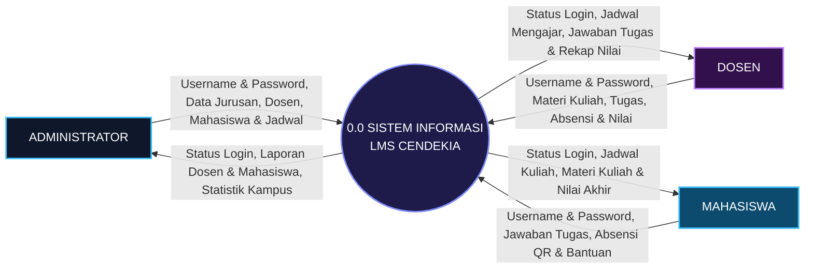

### Penjelasan Alur Diagram Konteks (DCD):
1. **Administrator**:
   - **Data Masuk**: Memasukkan `Username & Password`, data jurusan & mata kuliah, data akun dosen & mahasiswa, serta penataan jadwal kuliah.
   - **Informasi Keluar**: Menerima `Status Login` (masuk ke dashboard admin), laporan akun pengguna, dan statistik kampus.
2. **Dosen**:
   - **Data Masuk**: Memasukkan `Username & Password`, file materi kuliah, rincian tugas, pembukaan absensi, dan nilai mahasiswa.
   - **Informasi Keluar**: Menerima `Status Login` (masuk ke dashboard dosen), jadwal mengajar harian, jawaban tugas mahasiswa, dan rekapitulasi nilai.
3. **Mahasiswa**:
   - **Data Masuk**: Memasukkan `Username & Password`, lembar jawaban tugas, scan kode QR untuk absen, dan tiket keluhan jika ada kendala.
   - **Informasi Keluar**: Menerima `Status Login` (masuk ke dashboard mahasiswa), jadwal kuliah mingguan, modul materi ajar, dan nilai akhir.

---

## BAGIAN 3: DFD LEVEL 0 (6 PROSES UTAMA)

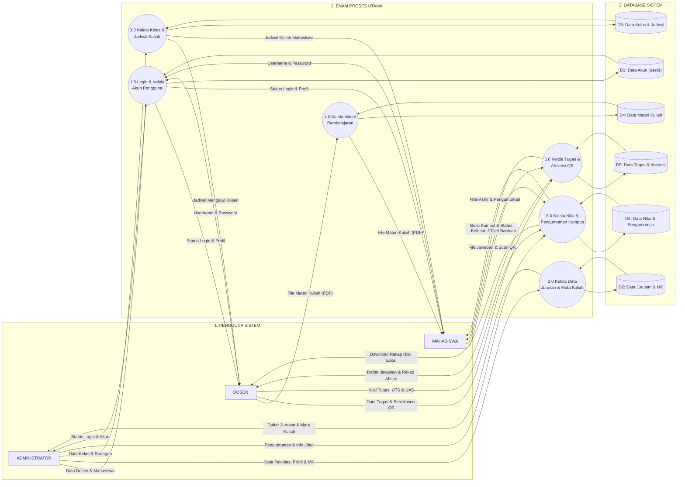

### Penjelasan 6 Proses Utama DFD Level 0:
1. **1.0 Login & Kelola Akun**: Memeriksa username/password saat login dan mengelola akun dosen/mahasiswa pada tabel `users` (D1).
2. **2.0 Kelola Data Jurusan & MK**: Mengatur fakultas, prodi, mata kuliah, dan semester aktif pada tabel master kampus (D2).
3. **3.0 Kelola Kelas & Jadwal**: Membuka kelas baru, menugaskan dosen pengampu, dan mengatur jam/ruangan pada tabel kelas & jadwal (D3).
4. **4.0 Kelola Materi**: Dosen mengunggah materi (PDF), mahasiswa membaca di web atau mendownload dari tabel materi (D4).
5. **5.0 Kelola Tugas & Absensi QR**: Dosen membuat tugas dan menyalakan absensi kode QR; mahasiswa mengumpulkan file tugas dan scan QR pada tabel tugas & absensi (D5).
6. **6.0 Kelola Nilai & Pengumuman**: Dosen menginput nilai UTS/UAS untuk hitung nilai akhir otomatis, admin memposting pengumuman dan melayani bantuan pada tabel nilai & layanan (D6).

---

## BAGIAN 4: DFD LEVEL 1 (DIPISAH PER SUB-PROSES)

Setiap sub-proses berikut disajikan secara mandiri: **diagram Mermaid di atas $\rightarrow$ penjelasan di bawah**.

---

### 4.1 Proses 1.0: Login & Kelola Akun Pengguna

#### 4.1.1 Sub-proses 1.1: Login & Cek Hak Akses Akun

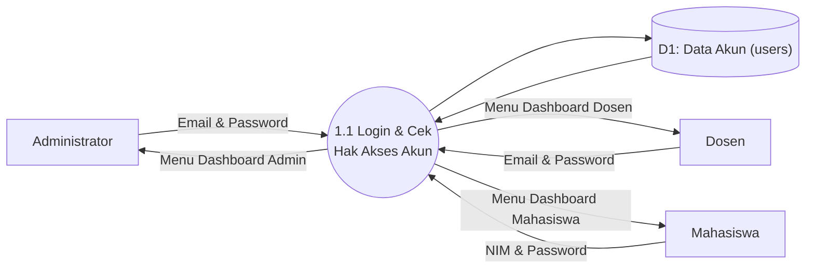

**Penjelasan Sub-proses 1.1:**
- Setiap pengguna (Admin, Dosen, Mahasiswa) memasukkan email/NIM dan kata sandi.
- Sistem mencocokkan data ke basis data `users` (D1).
- Jika data cocok, sistem memberikan hak akses dan mengarahkan pengguna ke dashboard perannya masing-masing.

---

#### 4.1.2 Sub-proses 1.2: Ubah Profil & Kata Sandi

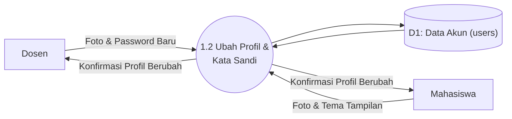

**Penjelasan Sub-proses 1.2:**
- Dosen dan mahasiswa dapat memperbarui biodata pribadi, mengunggah foto profil, dan mengganti password akun.
- Mahasiswa dan dosen juga dapat memilih mode tema tampilan (Terang atau Gelap/Dark Mode).
- Data pembaruan disimpan ke tabel `users` (D1).

---

#### 4.1.3 Sub-proses 1.3: Kelola Akun Dosen & Mahasiswa

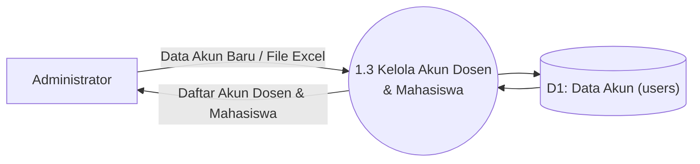

**Penjelasan Sub-proses 1.3:**
- Administrator mendaftarkan akun baru dosen (lengkap dengan NIP/NIDN) dan mahasiswa (lengkap dengan NIM dan jurusan).
- Pendaftaran akun bisa dilakukan satu per satu melalui formulir web atau secara massal dengan mengunggah file spreadsheet Excel.
- Data disimpan ke tabel `users` (D1) dan Admin dapat melihat daftar seluruh akun yang aktif.

---

### 4.2 Proses 2.0: Kelola Data Jurusan & Mata Kuliah

#### 4.2.1 Sub-proses 2.1: Kelola Data Fakultas & Jurusan / Prodi

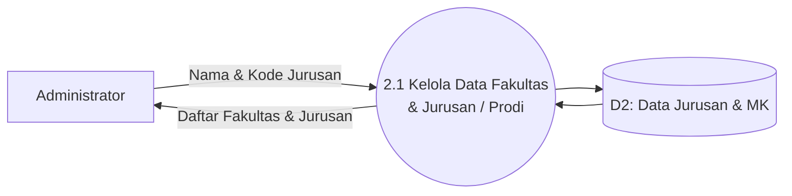

**Penjelasan Sub-proses 2.1:**
- Admin memasukkan data fakultas dan program studi/jurusan baru ke dalam sistem.
- Sistem menyimpan data kode dan nama jurusan ke tabel master (D2) untuk digunakan pada pendaftaran mahasiswa dan pembagian kelas.

---

#### 4.2.2 Sub-proses 2.2: Kelola Data Mata Kuliah & SKS

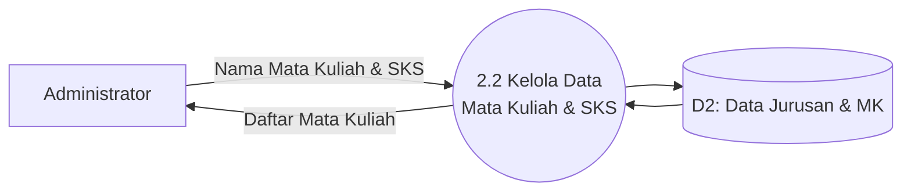

**Penjelasan Sub-proses 2.2:**
- Admin mengelola kurikulum mata kuliah dengan menginput nama mata kuliah, kode resmi, dan bobot Satuan Kredit Semester (SKS).
- Data tersimpan di tabel `mata_kuliah` (D2) sebagai acuan kelas perkuliahan.

---

#### 4.2.3 Sub-proses 2.3: Kelola Tahun Ajaran & Semester Aktif

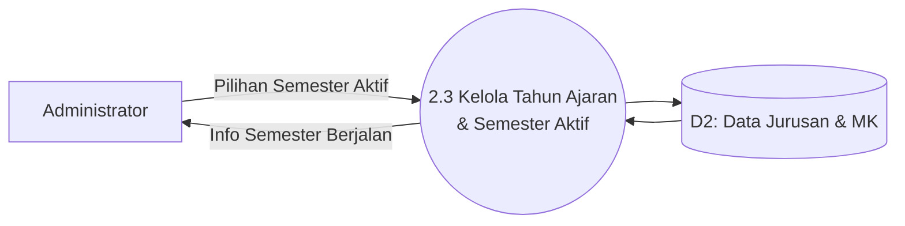

**Penjelasan Sub-proses 2.3:**
- Admin mengaktifkan tahun ajaran dan semester yang sedang berjalan (contoh: Semester Ganjil 2024/2025).
- Semester aktif ini menentukan kelas dan jadwal kuliah yang akan muncul di layar dosen dan mahasiswa.

---

### 4.3 Proses 3.0: Kelola Kelas & Jadwal Kuliah

#### 4.3.1 Sub-proses 3.1: Buka Kelas Kuliah & Kuota Mahasiswa

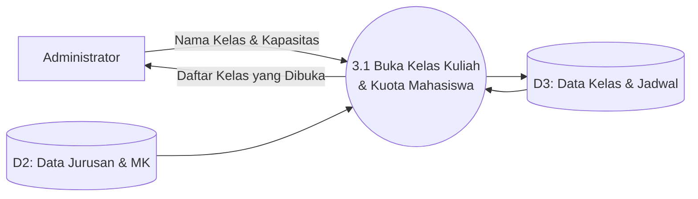

**Penjelasan Sub-proses 3.1:**
- Admin membuka ruang kelas kuliah baru berdasarkan mata kuliah dari master (D2).
- Admin menentukan kapasitas maksimal kuota mahasiswa pada kelas tersebut, lalu disimpan ke tabel `kelas_perkuliahan` (D3).

---

#### 4.3.2 Sub-proses 3.2: Pilih Dosen Pengampu Kelas

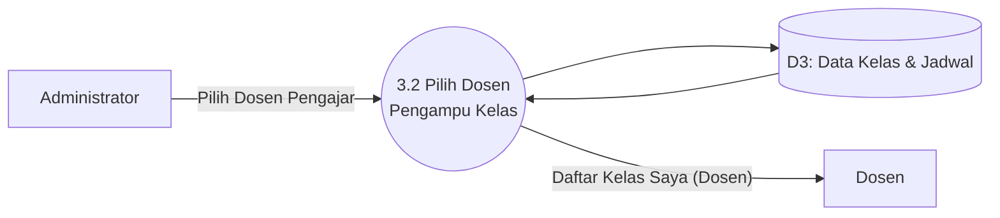

**Penjelasan Sub-proses 3.2:**
- Admin memilih dosen yang ditugaskan untuk mengajar pada ruang kelas tersebut.
- Kelas yang telah terhubung langsung muncul pada menu **Kelas Saya** di dashboard dosen pengampu.

---

#### 4.3.3 Sub-proses 3.3: Atur Hari, Jam & Ruangan Kuliah

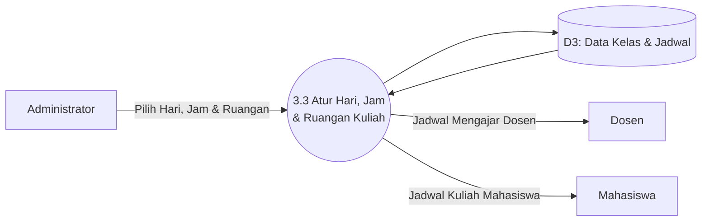

**Penjelasan Sub-proses 3.3:**
- Admin menyusun jadwal tatap muka mingguan dengan memilih hari perkuliahan, jam mulai sampai selesai, dan nomor ruangan kelas.
- Jadwal tersimpan di tabel `kelas_jadwals` (D3) dan dapat dilihat oleh dosen sebagai agenda mengajar serta oleh mahasiswa sebagai jadwal kuliah mingguan.

---

#### 4.3.4 Sub-proses 3.4: Ganti Jadwal Kuliah (Reschedule)

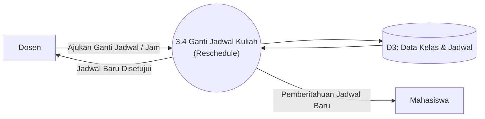

**Penjelasan Sub-proses 3.4:**
- Jika dosen berhalangan mengajar pada jadwal biasa, dosen dapat mengajukan jadwal pengganti (*reschedule*) untuk pertemuan tertentu.
- Sistem memperbarui data jadwal di database (D3) dan mengirim pemberitahuan jadwal kuliah baru kepada seluruh mahasiswa di kelas tersebut.

---

### 4.4 Proses 4.0: Kelola Materi Pembelajaran

#### 4.4.1 Sub-proses 4.1: Upload Materi Kuliah (PDF / Dokumen)

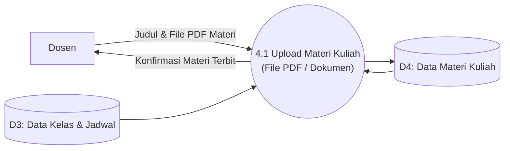

**Penjelasan Sub-proses 4.1:**
- Dosen memilih nomor pertemuan perkuliahan di dalam kelasnya, mengisi judul topik bahasan, dan mengunggah berkas materi (PDF atau presentasi PPT).
- Berkas disimpan di server storage dan datanya dicatat pada tabel `materi` & `materi_files` (D4).

---

#### 4.4.2 Sub-proses 4.2: Baca Online & Download Materi

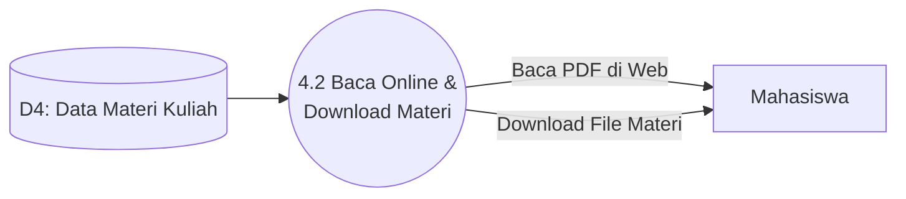

**Penjelasan Sub-proses 4.2:**
- Mahasiswa membuka tab **Materi** pada kelas yang diikutinya.
- Mahasiswa dapat langsung membaca dokumen PDF di dalam peramban web (*in-browser PDF preview*) atau mendownload file materi untuk dipelajari luring.

---

### 4.5 Proses 5.0: Kelola Tugas & Absensi QR

#### 4.5.1 Sub-proses 5.1: Buat Tugas Kuliah & Atur Deadline

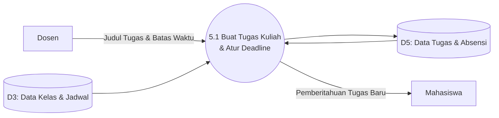

**Penjelasan Sub-proses 5.1:**
- Dosen membuat penugasan baru dengan mengisi instruksi tugas, bobot nilai, serta batas akhir pengumpulan (*deadline*).
- Informasi tugas disimpan ke tabel `tugas` (D5) dan notifikasi tugas baru muncul di portal mahasiswa.

---

#### 4.5.2 Sub-proses 5.2: Kumpul File Jawaban Mahasiswa

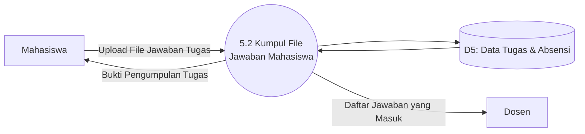

**Penjelasan Sub-proses 5.2:**
- Mahasiswa mengunggah file pengerjaan tugas (PDF/Word/ZIP) sebelum batas waktu ditutup.
- Sistem menerbitkan tanda bukti pengiriman dan dosen dapat melihat daftar berkas tugas yang sudah dikumpulkan di tabel `pengumpulan_tugas` (D5).

---

#### 4.5.3 Sub-proses 5.3: Buka Sesi Absen & Tampilkan Kode QR

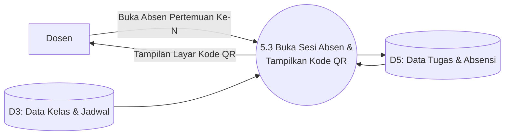

**Penjelasan Sub-proses 5.3:**
- Saat perkuliahan dimulai, dosen membuka sesi absensi untuk pertemuan tersebut dan mengatur durasi aktif (misal 30 menit).
- Sistem membangkitkan token acak dan menampilkan **Kode QR Dinamis** di layar proyektor kelas atau monitor dosen dari tabel `absensi` (D5).

---

#### 4.5.4 Sub-proses 5.4: Scan QR & Catat Kehadiran Mahasiswa

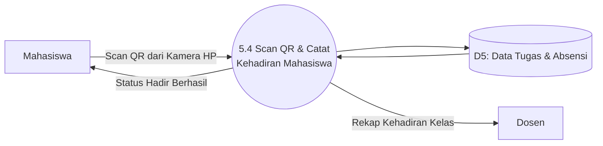

**Penjelasan Sub-proses 5.4:**
- Mahasiswa membuka tab presensi di ponselnya, memindai kode QR yang ditampilkan dosen, dan sistem langsung mencatat status **Hadir**.
- Data kehadiran tersimpan di tabel `absensi_mahasiswa` (D5) dan rekap kehadiran kelas langsung diperbarui di layar dosen.

---

### 4.6 Proses 6.0: Kelola Nilai & Pengumuman Kampus

#### 4.6.1 Sub-proses 6.1: Beri Nilai Tugas & Catatan Ulasan Dosen

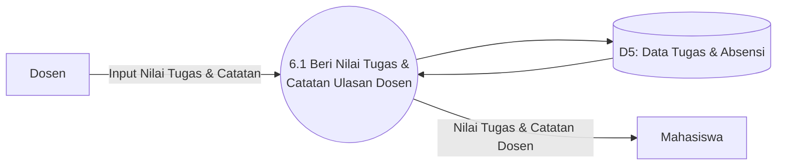

**Penjelasan Sub-proses 6.1:**
- Dosen memeriksa lembar kerja tugas mahasiswa, memberikan nilai angka (0-100), dan menulis ulasan umpan balik.
- Mahasiswa dapat langsung membaca perolehan nilai tugas beserta catatan saran dari dosen.

---

#### 4.6.2 Sub-proses 6.2: Input UTS/UAS & Hitung Nilai Akhir

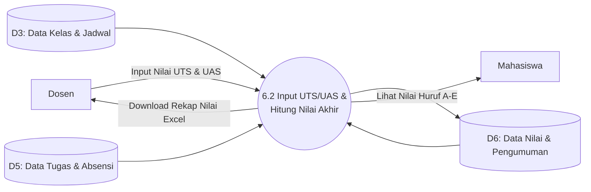

**Penjelasan Sub-proses 6.2:**
- Dosen menginput nilai UTS dan UAS di menu **Gradebook**.
- Sistem secara otomatis menghitung akumulasi nilai akhir terbobot (Tugas, Absensi, UTS, UAS) dan mengonversinya menjadi nilai huruf (A, B, C, D, E) pada tabel `nilai_akhir` (D6).
- Dosen dapat mengunduh rekap nilai ke format Excel, dan mahasiswa dapat melihat transkrip nilai per mata kuliah.

---

#### 4.6.3 Sub-proses 6.3: Buat Pengumuman & Kalender Akademik

```mermaid
flowchart LR
    E1["Administrator"]
    E2["Dosen"]
    E3["Mahasiswa"]
    P6_3(("6.3 Buat Pengumuman &<br>Kalender Akademik"))
    D6[("D6: Data Nilai & Pengumuman")]

    E1 -- "Isi Pengumuman & Info Libur" --> P6_3
    P6_3 --> D6
    D6 --> P6_3
    P6_3 -- "Pengumuman Kampus Terbaru" --> E2
    P6_3 -- "Pengumuman Kampus Terbaru" --> E3
```

**Penjelasan Sub-proses 6.3:**
- Admin menerbitkan berita pengumuman resmi kampus dan menetapkan tanggal ujian, minggu tenang, serta libur pada kalender akademik.
- Pengumuman dan linimasa agenda tersimpan di tabel `pengumuman` & `kalender_akademik` (D6) yang tampil di dashboard dosen dan mahasiswa.

---

#### 4.6.4 Sub-proses 6.4: Pusat Bantuan & Jawaban Tiket Keluhan

```mermaid
flowchart LR
    E3["Mahasiswa"]
    E2["Dosen"]
    E1["Administrator"]
    P6_4(("6.4 Pusat Bantuan &<br>Jawaban Tiket Keluhan"))
    D6[("D6: Data Nilai & Pengumuman")]

    E3 -- "Kirim Keluhan Sistem" --> P6_4
    E2 -- "Kirim Keluhan Sistem" --> P6_4
    P6_4 --> D6
    D6 --> P6_4
    E1 -- "Beri Solusi & Tutup Tiket" --> P6_4
    P6_4 -- "Jawaban Solusi Bantuan" --> E3
```

**Penjelasan Sub-proses 6.4:**
- Jika dosen atau mahasiswa mengalami kendala teknis (seperti galat akun atau gagal upload file), mereka mengirim tiket bantuan melalui menu *Help Center*.
- Tiket tersimpan di tabel `tickets` (D6), Admin memberikan balasan solusi teknis, dan menutup tiket setelah masalah terselesaikan.

---

## BAGIAN 5: ALUR PENGGUNAAN SISTEM (CARA KERJA TIAP PENGGUNA)

Berikut adalah tahapan praktis penggunaan sistem oleh masing-masing aktor:

---

### 5.1 Alur Kerja: ADMINISTRATOR

```mermaid
flowchart TD
    A1["1. Login Admin (Email & Password)"] --> A2["2. Buka Dashboard (Lihat Jumlah Mahasiswa, Dosen & Kelas)"]
    A2 --> A3["3. Isi Data Master (Fakultas, Jurusan/Prodi, Mata Kuliah & Semester)"]
    A3 --> A4["4. Buat Akun Dosen & Mahasiswa (Manual atau Upload File Excel)"]
    A4 --> A5["5. Buat Ruang Kelas Kuliah & Pilih Dosen Pengajarnya"]
    A5 --> A6["6. Buat Jadwal Kuliah (Pilih Hari, Jam & Ruangan Kelas)"]
    A6 --> A7["7. Posting Pengumuman Kampus & Tanggal Libur/Ujian di Kalender"]
    A7 --> A8["8. Jawab Tiket Bantuan jika Ada Mahasiswa/Dosen Mengalami Masalah"]
```

#### Langkah Kerja Administrator:
1. **Login ke Sistem**: Membuka halaman login, mengisi email dan password admin.
2. **Melihat Statistik**: Memantau jumlah mahasiswa aktif, dosen terdaftar, dan kelas yang dibuka.
3. **Mengisi Data Kampus**: Mendaftarkan fakultas, jurusan/prodi, mata kuliah beserta SKS, dan mengaktifkan semester berjalan.
4. **Membuat Akun**: Menambahkan akun dosen dan mahasiswa (bisa satu per satu atau sekaligus lewat file Excel).
5. **Membuka Kelas Kuliah**: Membuat ruangan kelas baru dan menunjuk dosen pengampu utamanya.
6. **Menyusun Jadwal**: Mengatur hari, jam mulai sampai selesai, serta ruangan kelas agar tidak bentrok.
7. **Membuat Pengumuman**: Memposting informasi kampus dan mengisi agenda libur/ujian di kalender akademik.
8. **Memberikan Bantuan**: Membuka menu *Help Center* untuk membaca dan menjawab tiket keluhan teknis pengguna.

---

### 5.2 Alur Kerja: DOSEN

```mermaid
flowchart TD
    D1["1. Login Dosen (Email & Password)"] --> D2["2. Buka Dashboard (Lihat Jadwal Mengajar Hari Ini)"]
    D2 --> D3["3. Buka Menu 'Kelas Saya' & Pilih Kelas Kuliah"]
    D3 --> D4["4. Upload Materi Kuliah (File PDF / Presentasi)"]
    D3 --> D5["5. Buka Sesi Absen & Tampilkan Kode QR di Layar Proyektor"]
    D3 --> D6["6. Buat Tugas Kuliah, Isi Petunjuk & Tentukan Batas Waktu"]
    D6 --> D7["7. Periksa Jawaban Mahasiswa & Beri Nilai Tugas"]
    D5 & D7 --> D8["8. Buka Gradebook: Hitung Nilai Absen, Isi Nilai UTS/UAS & Download Excel"]
    D2 --> D9["9. Fitur Lain: Gunakan AI Assistant & Ajukan Ganti Jadwal (Reschedule)"]
```

#### Langkah Kerja Dosen:
1. **Login Dosen**: Memasukkan email dan password dosen untuk masuk ke dashboard pribadi.
2. **Melihat Jadwal Mengajar**: Memeriksa agenda mengajar pada hari tersebut beserta ruangannya.
3. **Membuka Kelas**: Masuk ke menu **Kelas Saya** dan memilih kelas yang sedang diampu.
4. **Membagikan Materi**: Memilih nomor pertemuan dan mengunggah modul ajar (PDF/PPT) untuk dibaca mahasiswa.
5. **Menjalankan Absensi QR**: Menekan tombol buka absensi pertemuan dan memproyeksikan **Kode QR** di layar proyektor kelas.
6. **Memberikan Tugas**: Menuliskan judul tugas, instruksi, dan menentukan batas akhir pengumpulan (*deadline*).
7. **Menilai Tugas**: Mengoreksi file jawaban mahasiswa, memberikan skor nilai angka (0-100), dan menulis catatan masukan.
8. **Menghitung Nilai Akhir (Gradebook)**: Memasukkan nilai UTS dan UAS; sistem langsung menghitung nilai akhir dan nilai huruf (A-E) yang siap diunduh ke format Excel.
9. **Fitur Tambahan**: Berinteraksi dengan AI Assistant untuk merancang modul materi atau mengajukan ganti jadwal (*reschedule*).

---

### 5.3 Alur Kerja: MAHASISWA

```mermaid
flowchart TD
    M1["1. Login Mahasiswa (NIM & Password)"] --> M2["2. Buka Dashboard (Cek IPK, Jadwal Hari Ini & Tugas Mendesak)"]
    M2 --> M3["3. Buka Menu 'Schedule': Lihat Jadwal Kuliah Mingguan"]
    M2 --> M4["4. Buka Menu 'Kelas Saya' & Pilih Mata Kuliah"]
    M4 --> M5["5. Baca Materi Kuliah PDF Langsung di Web atau Download"]
    M4 --> M6["6. Absensi Kuliah: Scan Kode QR dari Layar Dosen"]
    M4 --> M7["7. Kumpul Tugas: Upload File Jawaban Sebelum Waktu Habis"]
    M2 --> M8["8. Cek Menu 'Gradebook': Lihat Nilai Tugas, Absen & Nilai Akhir"]
    M2 --> M9["9. Cek Pengumuman Kampus, Kalender Libur & Kirim Tiket jika Ada Masalah"]
```

#### Langkah Kerja Mahasiswa:
1. **Login Mahasiswa**: Mengetikkan NIM dan password mahasiswa untuk membuka portal akademik.
2. **Melihat Dashboard Pribadi**: Mengecek ringkasan nilai IPK, jadwal kuliah hari ini, dan tugas yang harus segera diselesaikan.
3. **Mengecek Jadwal Mingguan**: Memeriksa menu **Schedule** untuk melihat jam dan ruangan kuliah dari Senin sampai Jumat.
4. **Masuk ke Ruang Kelas**: Membuka menu **Kelas Saya** dan memilih mata kuliah yang sedang diikuti.
5. **Belajar Mandiri**: Membuka materi ajar mingguan langsung di peramban web atau mendownload modulnya.
6. **Melakukan Absensi QR**: Mengarahkan kamera HP ke kode QR di layar proyektor dosen untuk konfirmasi kehadiran otomatis.
7. **Mengumpulkan Tugas**: Mengunggah berkas jawaban tugas (PDF/Word/ZIP) sebelum batas waktu ditutup dan menerima bukti kirim.
8. **Melihat Transparansi Nilai**: Membuka menu **Gradebook** untuk melihat nilai tugas, persentase kehadiran, UTS, UAS, dan nilai mutu huruf.
9. **Layanan Bantuan & Info**: Membaca kalender akademik kampus dan mengirim tiket pengaduan ke admin jika terjadi gangguan akun.

---

## BAGIAN 6: TABEL RINGKASAN ALIRAN DATA SISTEM

| Pengguna | Data yang Diinputkan | No. Proses | Disimpan di Database | Informasi yang Diterima Pengguna |
| :--- | :--- | :---: | :--- | :--- |
| **Admin, Dosen, Mahasiswa** | Username & Password | **1.1** | `D1: Data Akun (users)` | Status Berhasil Login & Menu Dashboard |
| **Dosen, Mahasiswa** | Foto Profil & Password Baru | **1.2** | `D1: Data Akun (users)` | Tampilan Profil Baru (Mode Terang/Gelap) |
| **Admin** | Data Akun Baru / File Excel | **1.3** | `D1: Data Akun (users)` | Daftar Akun Dosen & Mahasiswa Terdaftar |
| **Admin** | Data Fakultas, Jurusan, MK & Semester | **2.1 - 2.3**| `D2: Data Jurusan & MK` | Katalog Data Master Kampus Lengkap |
| **Admin** | Kuota Mahasiswa & Nama Kelas Baru | **3.1** | `D3: Data Kelas & Jadwal` | Ruang Kelas Resmi Dibuka |
| **Admin** | Penunjukan Dosen yang Mengajar | **3.2** | `D3: Data Kelas & Jadwal` | Menu Kelas Saya pada Akun Dosen |
| **Admin** | Hari Kuliah, Jam & Ruangan Kelas | **3.3** | `D3: Data Kelas & Jadwal` | Jadwal Kuliah Dosen & Mahasiswa |
| **Dosen** | Usulan Ganti Hari / Jam Kuliah | **3.4** | `D3: Data Kelas & Jadwal` | Jadwal Pengganti yang Disetujui |
| **Dosen** | File Modul Kuliah (PDF / PPT) | **4.1** | `D4: Data Materi Kuliah` | Konfirmasi Materi Berhasil Terbit |
| **Mahasiswa** | Pilihan Modul yang Ingin Dibaca | **4.2** | `D4: Data Materi Kuliah` | Tampilan Baca PDF & File Download |
| **Dosen** | Judul Tugas, Petunjuk & Batas Waktu | **5.1** | `D5: Data Tugas & Absensi`| Notifikasi Tugas Baru di Dashboard Mahasiswa |
| **Mahasiswa** | File Lembar Jawaban Tugas | **5.2** | `D5: Data Tugas & Absensi`| Daftar Jawaban Masuk & Bukti Kumpul |
| **Dosen** | Buka Sesi Absen Pertemuan Ke-N | **5.3** | `D5: Data Tugas & Absensi`| Tampilan Layar Kode QR Absensi |
| **Mahasiswa** | Scan Kode QR Menggunakan HP | **5.4** | `D5: Data Tugas & Absensi`| Status Hadir Mahasiswa & Rekap Absen |
| **Dosen** | Nilai Tugas & Catatan Masukan | **6.1** | `D5: Data Tugas & Absensi`| Nilai Tugas & Masukan dari Dosen |
| **Dosen** | Nilai Ujian (UTS & UAS) | **6.2** | `D6: Data Nilai & Pengumuman`| Rekap Nilai Excel & Nilai Huruf A-E |
| **Admin, Dosen** | Isi Pengumuman & Agenda Kalender | **6.3** | `D6: Data Nilai & Pengumuman`| Papan Berita Pengumuman & Kalender Libur |
| **Mahasiswa, Dosen** | Uraian Masalah / Kendala Sistem | **6.4** | `D6: Data Nilai & Pengumuman`| Jawaban Solusi Masalah dari Admin |
