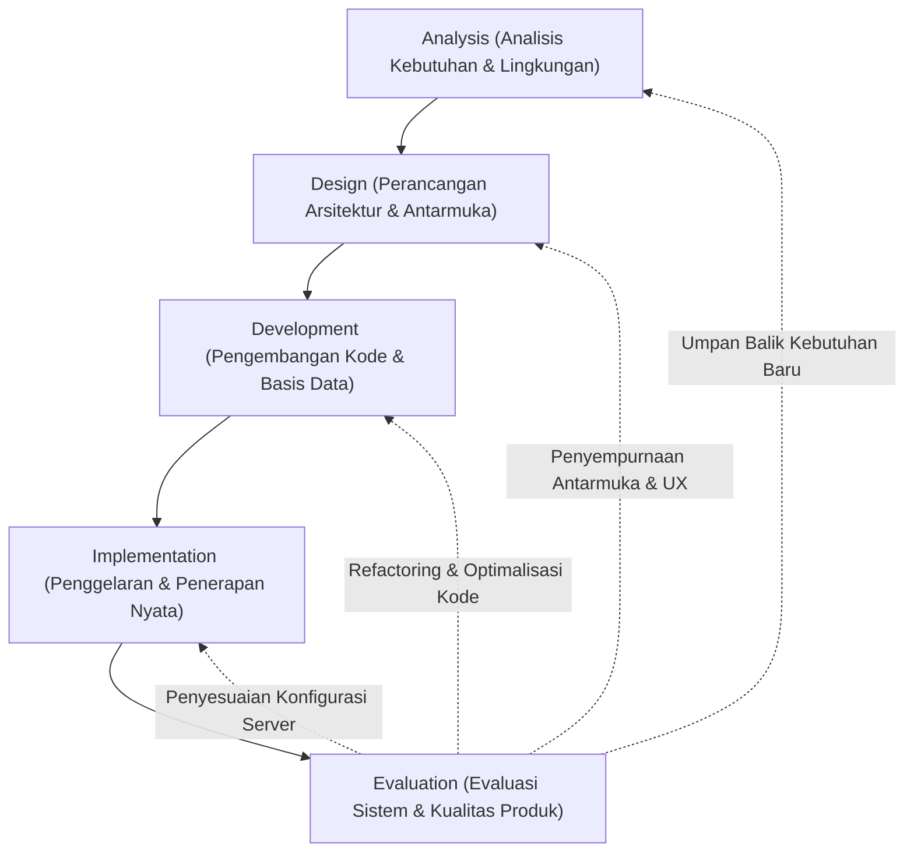
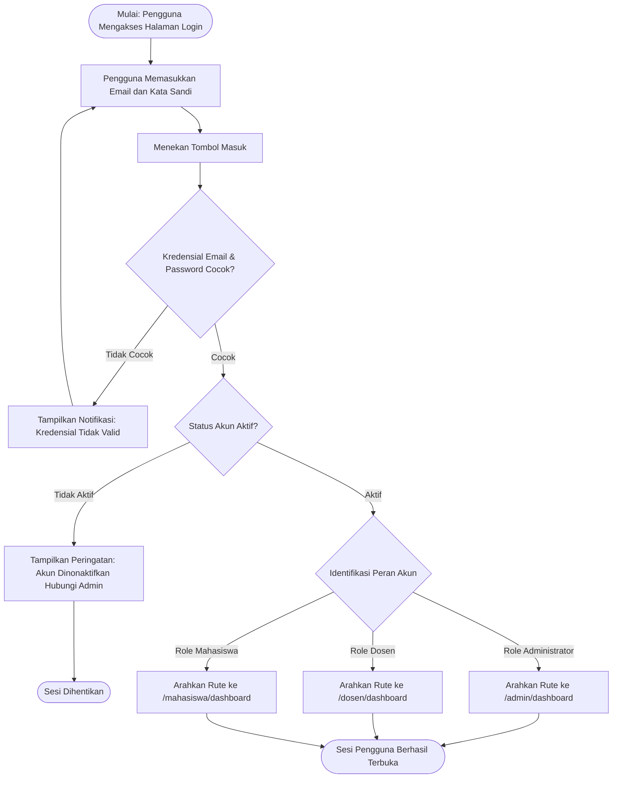
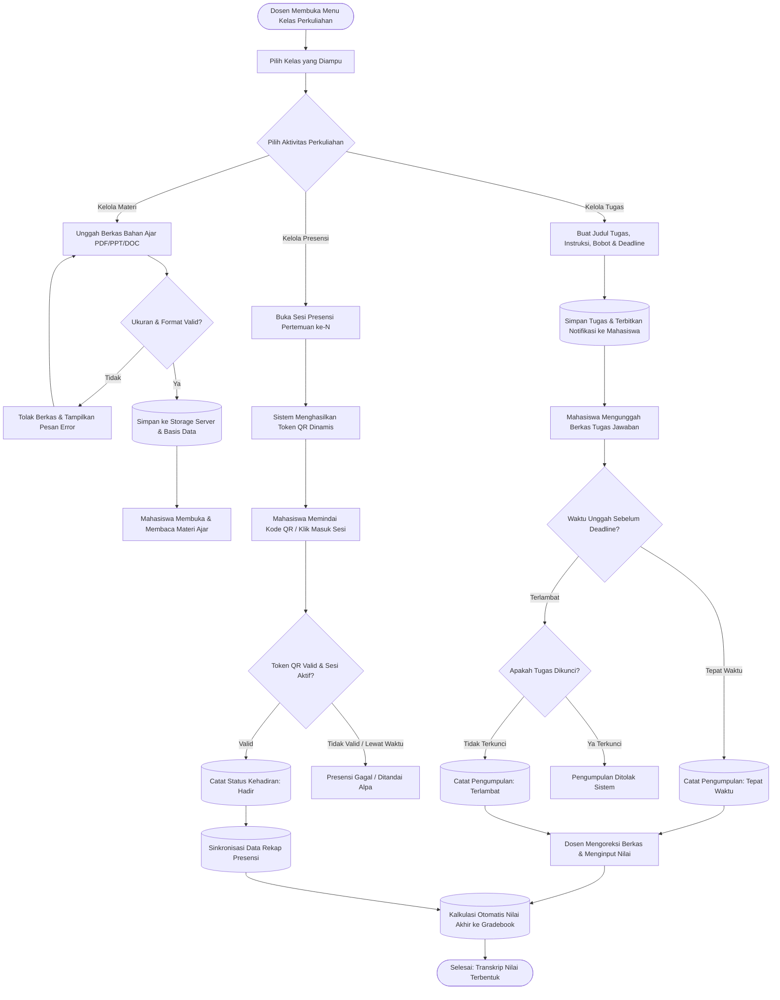
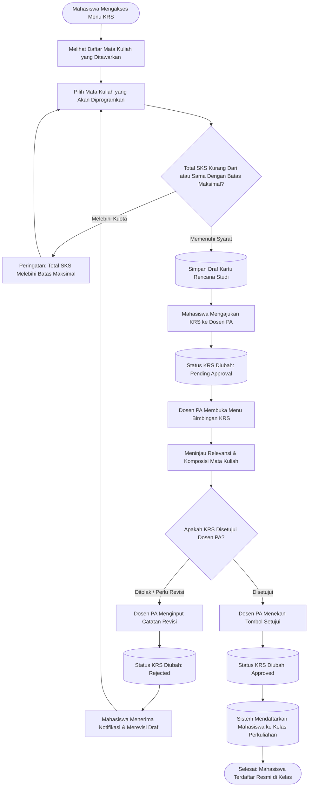

# BAB III LANDASAN TEORI

Bab ini menyajikan teori-teori dasar, prinsip pedagogis, serta kerangka metodologis rekayasa perangkat lunak yang menjadi pedoman dalam penelitian dan pengembangan aplikasi web Learning Management System (LMS) Cendekia. Landasan teori ini menguraikan konsep-konsep esensial yang relevan dengan transformasi pembelajaran digital, arsitektur sistem berbasis web, serta peran teknologi informasi dalam memfasilitasi ekosistem pendidikan tinggi yang kolaboratif, adaptif, dan akuntabel. Penelitian dan pengembangan sistem ini menerapkan model ADDIE sebagai metode kerja bertahap, terstruktur, dan berulang (iterative).

Gambar 3. 1 Kerangka Kerja ADDIE dalam Rekayasa Perangkat Lunak LMS Cendekia

Model ADDIE merupakan singkatan dari Analysis (Analisis), Design (Perancangan), Development (Pengembangan), Implementation (Implementasi), dan Evaluation (Evaluasi). Kerangka kerja ini pertama kali dirumuskan pada dekade 1970-an untuk perancangan sistem instruksional militer di Florida State University dan kini telah bermutasi menjadi standar metodologis universal dalam pengembangan media pembelajaran interaktif serta perangkat lunak edukasi modern. Sifat model ADDIE yang bertahap dan berulang menjamin bahwa setiap luaran pada fase tertentu selalu diverifikasi sebelum melangkah ke fase berikutnya, dan setiap temuan evaluasi dapat dialirkan kembali ke fase perancangan maupun pengembangan untuk perbaikan berkesinambungan.

## 3.1 Analisis (Analysis)

Fase analisis merupakan batu penjuru dari keseluruhan daur hidup pengembangan sistem. Pada tahap ini, pengembang mengidentifikasi kesenjangan antara proses manajemen pembelajaran konvensional dengan tuntutan efisiensi era digital, memetakan profil pemangku kepentingan, serta menentukan batasan fungsional perangkat lunak yang akan dibangun. Dalam konteks pengembangan LMS Cendekia, analisis komprehensif mencakup aspek-aspek fundamental berikut:

### 3.1.1 Sistem Manajemen Pembelajaran (Learning Management System - LMS)
Learning Management System (LMS) didefinisikan sebagai platform perangkat lunak berbasis komputer atau jejaring web yang dirancang secara khusus untuk memfasilitasi otomasi administrasi, pelacakan proses pembelajaran, distribusi bahan ajar multimedia, pengelolaan tugas perkuliahan, serta fasilitasi komunikasi interaktif antara pendidik dan peserta didik. Secara teoretis, LMS bertindak sebagai representasi ruang kelas virtual yang mereplikasi seluruh interaksi pedagogis di dunia nyata ke dalam format digital tanpa batas sekat geografis dan batasan waktu fisik.

Dalam ranah pendidikan tinggi modern, penerapan LMS bukan sekadar instrumen pendukung substitusi dokumen fisik, melainkan pusat syaraf dari pembelajaran bauran (blended learning) dan pembelajaran jarak jauh penuh (fully online learning). LMS yang efektif harus mampu mendukung konstruktivisme sosial, yaitu sebuah paradigma pembelajaran di mana pengetahuan dibangun bersama melalui diskusi kolaboratif, pemecahan studi kasus kelompok, umpan balik yang cepat dari pengajar, serta transparansi evaluasi kemajuan belajar peserta didik.

### 3.1.2 Platform Web LMS Cendekia
LMS Cendekia dirancang dan dikembangkan untuk menjawab problematika fragmentasi informasi akademik di lingkungan kampus. Platform ini mengusung pendekatan terpadu yang memadukan manajemen perkuliahan harian dengan tata kelola administrasi akademik kelembagaan. Arsitektur LMS Cendekia dibangun di atas prinsip pembagian wewenang berbasis peran (multi-role hierarchy) yang terbagi menjadi tiga tingkatan pengguna utama:
- Administrator: Berfungsi sebagai otoritas tertinggi sistem yang mengelola master data institusi (fakultas, program studi, kurikulum mata kuliah, dan tahun akademik), mengawasi akun pengguna, mengatur kalender kegiatan kampus, memonitor log aktivitas audit, serta menangani tiket kendala teknis.
- Dosen: Berfungsi sebagai fasilitator pembelajaran yang mengelola kelas perkuliahan, menyusun repositori materi pembelajaran digital, menerbitkan tugas mandiri maupun terstruktur, membuka sesi presensi pintar, membimbing forum diskusi, mengelola pembobotan buku nilai (gradebook), serta mengevaluasi rencana studi mahasiswa bimbingan (KRS).
- Mahasiswa: Berfungsi sebagai subjek pembelajar aktif yang mengakses jadwal kuliah terpadu, mempelajari modul ajar, mengunggah penugasan tepat waktu, melakukan presensi digital menggunakan perangkat pintar, berinteraksi dalam forum tanya jawab, merencanakan kartu rencana studi, serta memantau perkembangan nilai secara transparan.

### 3.1.3 Interaktivitas, Presensi Digital, dan Komunikasi Kolaboratif
Tingkat keberhasilan pembelajaran daring sangat berkorelasi positif dengan intensitas keterlibatan dan interaktivitas antar-pengguna di dalam sistem. Pembelajaran yang bersifat pasif berisiko menimbulkan fenomena kelelahan daring (zoom fatigue) dan penurunan motivasi belajar. Untuk mengantisipasi tantangan tersebut, LMS Cendekia mengintegrasikan instrumen interaktivitas mutakhir:
- Presensi Cerdas Berbasis Token QR: Menghilangkan kecurangan absensi konvensional (titip absen) dengan menerapkan kode QR dinamis yang dienkripsi dan memiliki jendela waktu kedaluwarsa singkat, serta dilengkapi pencatatan cap waktu (timestamp) kehadiran secara presisi.
- Forum Diskusi Terbimbing: Menerapkan struktur utas diskusi bertingkat (nested threads) per kelas perkuliahan, memungkinkan terjadinya diskursus ilmiah terarah antara dosen dan mahasiswa dengan dukungan penanda topik utama (pinned topic).
- Sistem Notifikasi Terpadu: Memberikan pengingat otomatis (alert notifications) terkait pembukaan tugas baru, batas akhir pengumpulan tugas yang mendekat, pengumuman akademik mendesak, serta perubahan jadwal kuliah.

### 3.1.4 Kerangka Kerja Laravel dan Ekosistem Rekayasa Web Modern
Pengembangan aplikasi web berskala enterprise seperti LMS Cendekia menuntut fondasi kerangka kerja yang memiliki performa tinggi, struktur kode yang bersih, dan standar keamanan yang kuat. Oleh karena itu, platform ini dibangun menggunakan kerangka kerja Laravel versi 11/13 dengan bahasa pemrograman PHP versi 8.3. Laravel dipilih karena mengimplementasikan pola arsitektur Model-View-Controller (MVC) yang memisahkan logika bisnis, lapisan akses basis data, dan tampilan antarmuka secara elegan:
- Lapisan Model (Eloquent ORM): Mengabstraksikan operasi basis data relasional menjadi objek-objek kode yang ekspresif, mendukung relasi kompleks seperti One-to-Many, Many-to-Many, dan Polimorfisme, serta menjamin proteksi otomatis terhadap kerentanan SQL Injection.
- Lapisan Controller: Mengatur alur logika bisnis, memvalidasi muatan masukan pengguna (form request validation), mengeksekusi otorisasi akses, serta menghubungkan data model ke lapisan tampilan.
- Lapisan View (Blade Templating Engine): Menyediakan struktur antarmuka modular dengan dukungan pewarisan template (template inheritance) dan komponen yang dapat digunakan ulang (reusable UI components).

Untuk lapisan penyajian antarmuka (frontend), sistem mengintegrasikan kombinasi teknologi modern:
- Tailwind CSS: Framework CSS berbasis utility-first yang memungkinkan pembuatan tata letak antarmuka yang sangat fleksibel, konsisten, dan memiliki ukuran berkas produksi yang sangat ringkas berkat mekanisme pembersihan gaya yang tidak terpakai (tree-shaking).
- Alpine.js: Pustaka JavaScript deklaratif yang sangat ringan untuk mengelola reaktivitas antarmuka lokal, seperti pembukaan jendela modal, menu dropdown, toggle sidebar, dan pembaruan visual instan tanpa overhead framework SPA yang besar.
- Vite: Perkakas kompilasi aset frontend generasi baru yang menyediakan Hot Module Replacement (HMR) berkecepatan tinggi pada fase pengembangan serta kompresi aset yang efisien pada fase produksi.
- Spatie Laravel-Permission: Pustaka manajemen kontrol akses berbasis peran (Role-Based Access Control / RBAC) yang mengontrol perizinan pengguna hingga level rute dan komponen tampilan.

### 3.1.5 Integrasi Kecerdasan Buatan (Artificial Intelligence Assistant) dalam LMS
Perkembangan teknologi kecerdasan buatan, khususnya model bahasa besar (Large Language Model / LLM), membuka babak baru dalam otomasi akademik. Dalam LMS Cendekia, modul AI Assistant disematkan secara terpadu untuk memangkas beban kerja administratif tenaga pendidik:
- Otomasi Penyusunan Bahan Ajar dan RPP: Membantu dosen merumuskan deskripsi materi perkuliahan, tujuan capaian pembelajaran (learning outcomes), dan petunjuk instruksional tugas secara terstruktur.
- Generator Bank Soal dan Evaluasi Otomatis: Menghasilkan paket soal ujian formatif maupun sumatif berdasarkan topik tertentu, lengkap dengan kunci jawaban, rubrik penilaian, serta utilitas ekspor instan ke format dokumen PDF siap cetak.
- Sistem Peringatan Dini Akademik (Early Warning System - EWS): Melakukan analisis analitik prediktif terhadap data keaktifan mahasiswa, akumulasi keterlambatan pengumpulan tugas, dan tren penurunan nilai presensi untuk memberikan sinyal kewaspadaan bagi Dosen Wali sebelum mahasiswa mengalami kegagalan studi.

## 3.2 Perancangan (Design)

Fase perancangan menerjemahkan dokumen spesifikasi kebutuhan hasil fase analisis menjadi cetak biru teknis yang terukur. Pada tahap ini, pengembang merancang diagram alir sistem, struktur basis data, arsitektur keamanan, serta panduan gaya visual antarmuka pengguna.

### 3.2.1 Diagram Alir (Flowchart) dan Pemodelan Sistem
Diagram alir (flowchart) merupakan representasi grafis standar yang menggambarkan urutan logika, instruksi komputasi, dan percabangan keputusan di dalam suatu program komputer. Dalam rekayasa LMS Cendekia, perancangan diagram alir memegang fungsi krusial:
1. Visualisasi Sekuensial: Menyajikan peta perjalanan navigasi pengguna secara runtut mulai dari tahap otentikasi akun hingga pengaksesan fitur mendalam di masing-masing modul.
2. Identifikasi Anomali dan Penanganan Eksepsi: Membantu tim rekayasa mendeteksi potensi kebuntuan alur (infinite loop), kegagalan validasi masukan, atau pelanggaran akses sebelum penulisan kode dimulai.
3. Sinkronisasi Antar-Anggota Tim: Menjadi jembatan komunikasi teknis antara pengembang basis data, pengembang logika backend, dan pengembang antarmuka frontend agar memiliki persepsi yang seragam terhadap aturan bisnis sistem.

### 3.2.2 Desain Antarmuka Ergonomis dan Sistem Tema Gelap (Dark Theme System)
Perancangan antarmuka pengguna pada LMS Cendekia berakar pada prinsip User-Centered Design (UCD) dan kepatuhan terhadap pedoman aksesibilitas web global (Web Content Accessibility Guidelines / WCAG 2.1 AA). Pertimbangan desain utama meliputi:
- Hirarki Visual yang Tegas: Menata penempatan elemen informasi, tipografi, dan tombol aksi berdasarkan skala prioritas kognitif pengguna agar navigasi terasa intuitif tanpa memerlukan pelatihan khusus.
- Desain Mobile-First yang Responsif: Memastikan seluruh komponen dashboard, kartu perkuliahan, dan tabel data dapat diakses dengan nyaman dari layar smartphone berukuran 360 piksel hingga monitor layar lebar beresolusi 4K.
- Sistem Tema Adaptif Tri-Mode: Mengimplementasikan sistem manajemen warna tiga opsi (Light Mode untuk kondisi ruangan terang, Dark Mode untuk kenyamanan penggunaan malam hari dan penghematan daya baterai pada panel OLED, serta Auto Mode yang tersinkronisasi otomatis dengan pengaturan tema sistem operasi perangkat pengguna).
- Skema Identitas Warna Berbasis Peran: Mengalokasikan palet warna aksen yang unik untuk membedakan konteks kerja pengguna:
  - Administrator mengadopsi palet Slate Dark Blue yang mencerminkan otoritas dan stabilitas sistem.
  - Dosen mengadopsi palet Royal Dark Purple yang merepresentasikan kebijaksanaan akademik dan kepemimpinan kelas.
  - Mahasiswa mengadopsi palet Deep Midnight Slate dan Sky Blue yang mencerminkan fokus belajar, kejernihan berpikir, dan energi eksplorasi.

### 3.2.3 Perancangan Relasi Basis Data Relasional
Basis data LMS Cendekia dirancang melalui proses normalisasi hingga Bentuk Normal Ketiga (3NF) untuk menghilangkan redundansi data, mencegah anomali pembaruan (update anomaly), dan menjamin integritas referensial antar-entitas. Seluruh relasi ketergantungan diikat menggunakan kunci asing (foreign keys) dengan aturan penghapusan bertingkat (cascading on delete) yang terukur guna menjaga konsistensi pangkalan data jangka panjang.

## 3.3 Pengembangan (Development)

Fase pengembangan merupakan tahap konkrit di mana seluruh cetak biru teknis diwujudkan ke dalam kode program yang berfungsi secara nyata. Aktivitas pengembangan dalam rekayasa LMS Cendekia dilaksanakan melalui disiplin rekayasa perangkat lunak modern:
1. Penyusunan Skema Basis Data Menggunakan Migrations: Mengonversi skema ERD ke dalam berkas migrasi Laravel sehingga riwayat perubahan struktur tabel tercatat secara kronologis dalam sistem kontrol versi Git.
2. Pengembangan Lapisan Model dan Logika Bisnis: Menyusun model Eloquent, mendefinisikan relasi antar-tabel, mengonfigurasi casting atribut data (seperti enkripsi kata sandi dan serialisasi JSON untuk opsi preferensi), serta menuliskan logika kueri efisien guna menghindari masalah kueri ganda (N plus 1 query problem) melalui teknik eager loading.
3. Pembangunan Lapisan Controller Modular: Mengisolasi pengontrol logika ke dalam tiga ruang nama (namespace) yang terpisah secara tegas (App/Http/Controllers/Admin, App/Http/Controllers/Dosen, dan App/Http/Controllers/Mahasiswa) guna menjaga prinsip Single Responsibility Principle (SRP).
4. Pembuatan Antarmuka Berbasis Komponen Blade: Mengembangkan komponen modular yang dapat digunakan berulang kali, seperti kartu statistik metrik, tabel dinamis dengan paginasi, jendela modal konfirmasi aksi berbahaya, lencana status berwarna, dan bilah progres penyelesaian perkuliahan.
5. Integrasi Pustaka Pemrosesan Dokumen dan Ekspor: Mengintegrasikan pustaka DomPDF untuk merender dokumen transkrip nilai dan jadwal perkuliahan menjadi berkas PDF berstandar cetak, serta pustaka Maatwebsite Excel untuk penanganan impor dan ekspor data massal mahasiswa dalam format spreadsheet.
6. Penegakan Protokol Keamanan Berlapis: Menerapkan token proteksi Cross-Site Request Forgery (CSRF) pada setiap pengiriman formulir POST/PUT/DELETE, sanitasi keluaran untuk menangkal serangan Cross-Site Scripting (XSS), enkripsi kata sandi menggunakan algoritma Bcrypt dengan cost factor adaptif, serta pengamanan tautan penyimpanan berkas tugas dan materi dari pengunduhan ilegal.

## 3.4 Implementasi (Implementation)

Fase implementasi mencakup serangkaian prosedur untuk menggelar, mengonfigurasi, dan mengoperasikan perangkat lunak yang telah dibangun pada lingkungan eksekusi yang sesungguhnya. Prosedur implementasi sistem LMS Cendekia mencakup:
- Penyiapan Lingkungan Peladen Lokal (Local Environment): Pemanfaatan piranti Laragon WAMP Stack yang menyediakan lingkungan PHP 8.3, web server Nginx/Apache, dan peladen basis data MySQL 8.0 dengan konfigurasi memori yang dioptimalkan untuk pengujian intensif.
- Pengelolaan Variabel Lingkungan (.env Configuration): Pemisahan ketat antara kredensial privat peladen (seperti kunci enkripsi APP_KEY, konfigurasi basis data, kredensial mail server, dan kunci API AI) dari repositori kode publik.
- Eksekusi Migrasi Skema dan Seeding Data Uji: Menjalankan eksekusi perintah terminal php artisan migrate dan pengisian data uji realistis (seeders) yang merepresentasikan struktur fakultas riil, puluhan mata kuliah, serta akun simulasi untuk pengujian lintas peran.
- Kompilasi Bundel Aset Produksi: Mengeksekusi instruksi npm run build untuk memadatkan seluruh berkas CSS dan JavaScript menjadi bundel terkompresi dengan tanda pengenal hash unik guna memaksimalkan efisiensi caching peramban.
- Penerapan Kontainerisasi Docker (Opsional untuk Lingkungan Cloud): Menyediakan berkas Dockerfile dan berkas konfigurasi multi-kontainer untuk memastikan aplikasi dapat dipindahkan dan dijalankan secara identik di berbagai peladen berbasis cloud tanpa kendala ketidakcocokan dependensi sistem operasi.

## 3.5 Evaluasi (Evaluation)

Evaluasi merupakan fase penutup yang sangat krusial dalam model ADDIE untuk menguji, memverifikasi, dan memvalidasi apakah produk akhir perangkat lunak telah memenuhi standar kualitas teknis serta mampu memecahkan kebutuhan riil pengguna. Evaluasi pada LMS Cendekia dilakukan melalui pendekatan pengujian komprehensif:
1. Pengujian Fungsional Sistem (Black Box Testing): Pengujian terstruktur untuk memeriksa kesesuaian antara masukan data dengan keluaran sistem pada setiap fitur tanpa memperhatikan struktur kode internal. Pengujian ini berfokus pada validasi formulir, keandalan pengunggahan berkas materi, kalkulasi nilai di gradebook, pemindaian QR absensi, serta keutuhan siklus pengajuan KRS.
2. Pengujian Otorisasi dan Keamanan Akses: Menguji ketahanan sistem terhadap upaya manipulasi tautan URL (URL tampering) di mana akun dengan hak akses mahasiswa mencoba mengakses fungsi administratif pada rute admin atau dosen.
3. Pengujian Penerimaan Pengguna (User Acceptance Testing - UAT): Melibatkan perwakilan pengguna akhir sesungguhnya untuk menilai tingkat kemudahan pengoperasian (usability), estetika visual antarmuka, kejelasan pesan kesalahan, serta kenyamanan sistem tema adaptif.
4. Pengujian Kinerja dan Waktu Muat (Performance Benchmarking): Mengukur kecepatan pemuatan halaman awal, konsumsi memori server saat menangani kueri agregasi nilai massal, serta responsivitas rendering antarmuka pada koneksi jaringan internet yang bervariasi.

---

# BAB IV PEMBAHASAN

## 4.1 Analisis (Analysis)

### 4.1.1 Spesifikasi Perangkat Keras
Dalam pelaksanaan rekayasa, pengembangan, dan pengujian sistem web LMS Cendekia, perangkat keras yang digunakan oleh tim pengembang mencakup:
1. Komputer Pengembang Utama (Workstation Dewi Sekar Ayu):
   - Prosesor: 11th Gen Intel(R) Core(TM) i3-1115G4 @ 3.00GHz (4 CPUs)
   - Memori RAM: 8 GB DDR4 3200 MHz
   - Media Penyimpanan: 512 GB M.2 NVMe PCIe SSD berkecepatan baca-tulis tinggi
   - Tampilan Layar: 14.0 inci Full HD (1920 x 1080 piksel) Anti-Glare
   - Konektivitas Jaringan: Realtek Wi-Fi 5 (802.11ac) dan Bluetooth 5.0
2. Komputer Pengembang Pendukung (Workstation Marfa Triasa & May Lusi Rahmawati):
   - Prosesor: Intel Core i5 / AMD Ryzen 5 Quad-Core Processor
   - Memori RAM: 8 GB / 16 GB DDR4
   - Media Penyimpanan: 512 GB SSD
   - Tampilan Layar: 14.0 - 15.6 inci Full HD
3. Perangkat Uji Klien Seluler (Multi-Device Smartphone Testing):
   - Unit Uji Android: Layar 6.5 inci FHD plus (1080 x 2400 piksel) dengan kamera terintegrasi untuk pengujian pemindaian kode QR presensi dan verifikasi tata letak mobile drawer.
   - Unit Uji Tablet: Layar 10.1 inci untuk pengujian tampilan antarmuka mode tablet berorientasi lanskap.

### 4.1.2 Spesifikasi Perangkat Lunak
Perangkat lunak pendukung dan perkakas rekayasa yang dikonfigurasi dalam lingkungan pengembangan meliputi:
1. Sistem Operasi Utama: Microsoft Windows 11 Home / Pro 64-bit Architecture.
2. Lingkungan Eksekusi Server Lokal:
   - Laragon Development Suite v6.0.0
   - Apache HTTP Server v2.4.54 dengan modul rewrite aktif
   - Nginx HTTP Server v1.22.1
   - PHP Runtime Engine v8.3.6 (64-bit Non-Thread-Safe)
   - Basis Data MySQL Community Server v8.0.30
3. Kerangka Kerja dan Dependensi Utama Backend:
   - Laravel Framework v11.x / v13.x
   - Composer Dependency Manager v2.7.x
   - Spatie Laravel-Permission v8.1
   - Barryvdh Laravel-DomPDF v3.1
   - Maatwebsite Excel v4.0
4. Perkakas Pengembang Frontend dan Kompilasi:
   - Node.js Runtime Environment v20.12.x LTS
   - Node Package Manager (NPM) v10.5.x
   - Vite Modern Frontend Tooling v8.0.0
   - Tailwind CSS Utility Framework v3.4 / v4.0
   - Alpine.js Minimalist JavaScript Framework v3.4.2
   - PostCSS Engine v8.4 dan Autoprefixer v10.4
5. Editor Kode dan Sistem Kontrol Versi:
   - Visual Studio Code / Antigravity IDE dengan ekstensi Laravel Extra Intellisense, Tailwind CSS IntelliSense, dan PHP Intelephense
   - Git Distributed Version Control System v2.43.0
   - Repositori Daring GitHub dewisekarayu/cendekia
6. Piranti Pengujian Antarmuka dan Jaringan:
   - Google Chrome Browser v125+ dengan Chrome Developer Tools
   - Mozilla Firefox Developer Edition
   - Microsoft Edge Chromium
   - Postman API Testing Suite untuk pengujian endpoint internal

### 4.1.3 Analisis Kebutuhan Sistem LMS Cendekia
Berdasarkan investigasi terhadap alur kerja perkuliahan di lingkungan akademik, diuraikan spesifikasi kebutuhan fungsional dan non-fungsional sistem secara rinci:

A. Kebutuhan Fungsional Berdasarkan Aktor

1. Kebutuhan Fungsional Administrator:
   - Mengelola Master Fakultas: Menginput, memperbarui, menampilkan, dan menghapus entitas fakultas.
   - Mengelola Master Program Studi: Mengelola data jurusan, kode prodi, jenjang pendidikan, serta akreditasi.
   - Mengelola Master Tahun Akademik: Menetapkan tahun perkuliahan aktif dan semester operasional (Ganjil/Genap).
   - Mengelola Master Mata Kuliah: Mengatur kode mata kuliah, nama, bobot SKS, dan semester kurikulum.
   - Manajemen Akun Dosen: Menambah akun dosen secara individual maupun impor massal via berkas Excel/CSV, mengatur status keaktifan, serta mereset kata sandi akun.
   - Manajemen Akun Mahasiswa: Menambah akun mahasiswa baru, mengatur NIM, program studi, penetapan Dosen Pembimbing Akademik, serta ekspor data ke format PDF dan Excel.
   - Manajemen Kelas Terpusat: Mengatur alokasi dosen pengampu pada kelas perkuliahan, penentuan kapasitas ruang, dan plotting jadwal perkuliahan mingguan.
   - Manajemen Kalender Akademik: Menerbitkan agenda kegiatan kampus, menentukan rentang tanggal kegiatan, serta memfilter sasaran kegiatan (dosen, mahasiswa, atau umum).
   - Manajemen Pengumuman Global: Mempublikasikan warta pengumuman resmi institusi ke dashboard pengguna.
   - Manajemen Pengaturan Sistem: Menata profil kampus, logo institusi, nama aplikasi, dan preferensi umum sistem.
   - Pemantauan Help Center: Mengelola dan membalas tiket pertanyaan serta laporan kendala teknis yang dikirimkan oleh pengguna aplikasi.
   - Audit Log Aktivitas: Memantau rekaman jejak aktivitas pengguna untuk menjamin akuntabilitas keamanan data.

2. Kebutuhan Fungsional Dosen:
   - Dashboard Terintegrasi Dosen: Melihat ringkasan kelas aktif, rekapitulasi jumlah mahasiswa, jadwal mengajar hari ini, dan pemberitahuan tugas yang belum dinilai.
   - Manajemen Kelas Perkuliahan: Membuka kelas daring, melihat daftar mahasiswa yang terdaftar, serta mengatur silabus kelas.
   - Manajemen Materi Pembelajaran: Mengunggah berkas materi (PDF, DOCX, PPTX), menambahkan tautan video eksternal, memberikan deskripsi pengantar, serta menyediakan pratinjau dokumen langsung di peramban tanpa memaksa mahasiswa mengunduh berkas.
   - Manajemen Penugasan: Membuat tugas terstruktur, melampirkan berkas instruksi tugas, menetapkan batas waktu pengumpulan (deadline), mengunci pengumpulan tugas yang terlambat, menilai berkas tugas yang dikumpulkan mahasiswa, serta memberikan komentar koreksi.
   - Manajemen Presensi Digital: Membuka sesi absensi perkuliahan untuk pertemuan ke-1 hingga ke-16, menerbitkan token kode QR dinamis dengan batas waktu aktif, melakukan verifikasi status presensi (Hadir, Sakit, Izin, Alpa), serta memanfaatkan fitur penjadwalan ulang sesi (reschedule absensi).
   - Buku Nilai (Gradebook Engine): Mengatur persentase bobot komponen evaluasi (bobot tugas, kehadiran, UTS, dan UAS), melakukan sinkronisasi otomatis persentase kehadiran ke dalam buku nilai, serta mengekspor transkrip rekap nilai kelas ke berkas Excel.
   - Bimbingan Rencana Studi (KRS): Memeriksa daftar pengajuan kartu rencana studi mahasiswa bimbingan akademik, memverifikasi kesesuaian kuota SKS, serta menyetujui (approve) atau menolak (reject) pengajuan KRS disertai alasan revisi.
   - Modul AI Teaching Assistant: Berkomunikasi dengan agen cerdas untuk merumuskan bahan kajian materi perkuliahan, menyusun narasi instruksi tugas, merancang rubrik penilaian, serta membuat bank soal ujian yang dapat diekspor langsung ke dokumen PDF.
   - Forum Komunikasi Kelas: Membuat topik diskusi perkuliahan dan memberikan tanggapan ilmiah atas pertanyaan mahasiswa.

3. Kebutuhan Fungsional Mahasiswa:
   - Dashboard Mahasiswa: Memantau indeks prestasi, kartu jadwal perkuliahan hari ini, daftar tugas mendesak, serta pengumuman kampus.
   - Penjelajah dan Pendaftaran Kelas: Menemukan kelas perkuliahan yang ditawarkan dan bergabung ke kelas sesuai kurikulum yang diprogramkan.
   - Pembelajaran Materi Mandiri: Membaca materi ajar secara daring melalui penampil dokumen terintegrasi atau mengunduh bahan ajar untuk dipelajari luring.
   - Pengumpulan Tugas Mandiri: Mengunggah berkas jawaban tugas sesuai format yang diizinkan sebelum batas waktu berakhir, melihat status verifikasi tugas, serta membaca nilai dan umpan balik dosen.
   - Presensi Perkuliahan Mandiri: Melakukan konfirmasi kehadiran perkuliahan dengan memindai kode QR yang ditampilkan dosen atau menekan tombol konfirmasi kehadiran pada jendela waktu sesi yang dibuka.
   - Pemrograman KRS Daring: Memilih mata kuliah yang akan ditempuh pada semester berjalan sesuai kuota jatah SKS, mengajukan draf KRS ke Dosen Pembimbing Akademik, serta memantau status persetujuan KRS secara real-time.
   - Transparansi Buku Nilai: Memantau nilai tugas individual, nilai presensi terakumulasi, nilai ujian tengah semester, nilai ujian akhir semester, serta nilai akhir terkonversi (A hingga E).
   - Partisipasi Forum Diskusi: Menyampaikan pertanyaan materi kelas dan berdiskusi dengan rekan sekelas maupun dosen pengampu.
   - Pusat Bantuan (Help Center): Mengakses repositori pertanyaan umum (FAQ), melakukan pencarian solusi kendala, serta mengirimkan tiket keluhan langsung ke tim administrator.

B. Kebutuhan Non-Fungsional
- Aspek Keamanan (Security): Proteksi terhadap serangan injeksi SQL menggunakan Prepared Statements bawaan Eloquent ORM, perlindungan serangan CSRF pada seluruh transaksi formulir, enkripsi kata sandi menggunakan algoritma hashing Bcrypt dengan garam acak (salted hash), isolasi hak akses melalui middleware otorisasi, serta penanganan berkas unggahan dengan validasi tipe MIME yang ketat.
- Aspek Kinerja dan Efisiensi (Performance): Waktu muat halaman pertama kali di bawah 1,5 detik pada kecepatan jaringan standar 10 Mbps, pemanfaatan caching konfigurasi dan rute Laravel, kompresi aset melalui bundel Vite, serta pengoptimalan kueri basis data untuk mencegah masalah overhead pemrosesan.
- Aspek Keandalan (Reliability): Tingkat ketersediaan sistem yang tinggi dengan penanganan kesalahan terpusat (centralized exception handling) yang menampilkan pesan kesalahan yang ramah pengguna tanpa membocorkan struktur kode sensitif server.
- Aspek Aksesibilitas dan Ergonomi (Usability): Antarmuka adaptif yang responsif terhadap beragam dimensi layar perangkat, konsistensi ikonografi, navigasi yang intuitif, serta penyediaan tema gelap (Dark Theme) dengan rasio kontras warna yang memenuhi standar WCAG 2.1 AA guna menjaga kenyamanan penglihatan civitas akademika saat belajar di malam hari.

## 4.2 Perancangan (Design)

### 4.2.1 Diagram Alir Sistem (Flowchart)

A. Flowchart Autentikasi dan Alur Akses Berbasis Peran
Diagram alir berikut menggambarkan proses validasi kredensial pengguna, verifikasi status akun, dan pengalihan dinamis ke dashboard peran masing-masing:

Gambar 4. 2 Flowchart Autentikasi dan Alur Akses Berbasis Role

B. Flowchart Manajemen Pembelajaran dan Penilaian Terpadu
Diagram alir berikut menggambarkan interaksi perkuliahan antara dosen yang mengunggah bahan ajar, membuka absensi kode QR, memberikan tugas, dan menilai hasil kerja mahasiswa hingga terakumulasi ke dalam buku nilai:

Gambar 4. 3 Flowchart Siklus Pembelajaran dan Penilaian Perkuliahan

C. Flowchart Pemrograman dan Persetujuan Kartu Rencana Studi (KRS)
Diagram alir berikut menggambarkan proses registrasi akademik semesteran oleh mahasiswa dan verifikasi persetujuan oleh Dosen Pembimbing Akademik:

Gambar 4. 4 Flowchart Pemrograman dan Verifikasi Kartu Rencana Studi

---

### 4.2.2 Sekuens Modul dan Fitur Utama Web Cendekia
Platform LMS Cendekia diorganisasikan ke dalam 17 modul fungsional yang saling terhubung secara harmonis:

1. Modul Autentikasi dan Pengalihan Peran (Authentication & Role Gateway): Mengendalikan pintu masuk sistem dengan enkripsi kredensial, proteksi sesi peramban, penanganan token pemulihan kata sandi, serta pengalihan otomatis berdasarkan peran pengguna via middleware.
2. Modul Dashboard Analitik Terpadu (Multi-Role Analytics Dashboard): Pusat pemantauan operasional yang dirancang spesifik untuk tiap peran; menyajikan ringkasan statistik, bagan grafik performa, jadwal kalender mingguan, serta daftar agenda prioritas.
3. Modul Manajemen Master Data Organisasi Kampus: Instrumen bagi Administrator untuk menyusun struktur kelembagaan akademik mencakup entitas fakultas, dekanat, program studi, jenjang pendidikan, serta status akreditasi BAN-PT.
4. Modul Manajemen Kurikulum dan Mata Kuliah: Mengatur direktori mata kuliah kurikulum, kodefikasi resmi, bobot kredit semester (SKS), penentuan semester penawaran, serta pemetaan silabus pembelajaran.
5. Modul Manajemen Sivitas Akademika dan Penugasan Wali: Pengelolaan direktori pengguna dosen dan mahasiswa dengan dukungan penomoran identitas nasional (NIDN/NIP, NIM), penetapan Dosen Pembimbing Akademik, serta fasilitas impor dan ekspor data massal.
6. Modul Kelas Perkuliahan Digital (Virtual Classroom Engine): Jantung pembelajaran tempat bertemunya dosen pengampu dan mahasiswa, dilengkapi tab navigasi terpadu untuk mengakses materi, penugasan, presensi, buku nilai, dan forum diskusi.
7. Modul Repositori Bahan Ajar (Digital Learning Materials): Fasilitas unggah materi ajar multi-format dengan penampil dokumen PDF terintegrasi langsung di peramban, memudahkan mahasiswa belajar mandiri tanpa keharusan mengunduh berkas fisik ke perangkat lokal.
8. Modul Penugasan dan Evaluasi Tugas (Assignment & Grading Engine): Manajemen tugas terstruktur yang mendukung penentuan batas waktu penyerahan, opsi penguncian tugas terlambat, pembatasan jenis dan ukuran berkas jawaban, serta antarmuka penilaian dosen yang dilengkapi rubrik dan catatan umpan balik.
9. Modul Presensi Cerdas dengan Generator Token QR (Smart Attendance Engine): Pengelolaan sesi kehadiran perkuliahan dengan generator kode QR dinamis, validasi jendela waktu akses, pencatatan otomatis status kehadiran, rekapitulasi persentase absensi, serta fitur penjadwalan ulang sesi.
10. Modul Buku Nilai dan Komputasi Nilai Akhir (Gradebook Engine): Sistem komputasi evaluasi hasil belajar yang mengkalkulasi akumulasi nilai terbobot dari komponen tugas, kehadiran, UTS, dan UAS secara transparan, menghasilkan nilai angka dan konversi nilai huruf mutu (A sampai E).
11. Modul Forum Diskusi Terbimbing (Classroom Discussion Forum): Wadah komunikasi ilmiah dua arah berbentuk utas diskusi bertingkat per kelas perkuliahan guna menunjang paradigma konstruktivisme sosial.
12. Modul Kalender Akademik Terintegrasi (Integrated Campus Calendar): Visualisasi kalender interaktif yang merangkum seluruh kegiatan akademik institusi (masa perkuliahan, periode pengisian KRS, minggu ujian, hari libur nasional) dengan filter audiens target.
13. Modul Kartu Rencana Studi Daring (Online Study Plan / KRS): Fasilitas pemrograman mata kuliah mandiri oleh mahasiswa dengan pembatasan jatah SKS dinamis berdasarkan indeks prestasi semester sebelumnya, disertai alur verifikasi dan persetujuan bertingkat oleh Dosen PA.
14. Modul Asisten Pembelajaran Cerdas (AI Teaching Assistant): Integrasi model kecerdasan buatan untuk membantu dosen merancang rencana pembelajaran semester, menyusun narasi tugas, merumuskan deskripsi materi, serta menghasilkan bank soal ujian berformat dokumen PDF.
15. Modul Sistem Peringatan Dini Akademik (Early Warning System - EWS): Instrumen analitik prediktif untuk mendeteksi potensi penurunan prestasi belajar mahasiswa sejak dini berdasarkan tren absensi dan keterlambatan penyerahan tugas.
16. Modul Pusat Bantuan dan Tiket Kendala (Help Center & Ticketing): Halaman dukungan publik yang menyajikan direktori Frequently Asked Questions (FAQ) dengan mesin pencari cepat serta formulir pelaporan tiket kendala teknis bagi sivitas akademika.
17. Modul Pengaturan Sistem, Personalisasi, dan Tema Gelap: Manajemen profil personal, penggantian kata sandi, pengaturan filter preferensi notifikasi, dan selektor tema tri-mode (Terang, Gelap, Auto) yang tersinkronisasi ke basis data pengguna dan penyimpanan lokal peramban.

---

## 4.3 Pengembangan (Development)

### 4.3.1 Implementasi Antarmuka Pengguna dan Komponen Desain

A. Panel Dashboard Terpadu dan Sistem Navigasi Dinamis
Antarmuka sistem dikembangkan mengadopsi prinsip desain berbasis komponen Tailwind CSS. Panel navigasi utama (sidebar) dirancang dinamis dengan mekanisme buka-tutup (collapsible drawer) pada resolusi layar ponsel yang dikendalikan oleh pernyataan Alpine.js (x-data, x-show, x-transition). Indikator menu aktif menampilkan aksen warna identitas peran pengguna (Biru Langit untuk Admin, Ungu Pastel untuk Dosen, dan Biru Indigo untuk Mahasiswa) yang memberikan kejelasan konteks saat berpindah modul.

B. Arsitektur Tema Gelap Adaptif (Dark Theme Architecture)
Implementasi sistem tema gelap pada LMS Cendekia tidak sekadar membalikkan warna latar belakang menjadi hitam pekat, melainkan menggunakan palet warna gelap terkurasi yang ramah di mata:
- Mode Terang (Light Mode): Menggunakan latar belakang Slate 50 (heksadesimal #F8FAFC) dengan teks Slate 900 (#0F172A) untuk keterbacaan tajam di lingkungan ruangan berpencahayaan tinggi.
- Mode Gelap (Dark Mode): Menggunakan latar belakang Slate 900 (#0F172A) untuk Admin, Purple 950 (#1E1B4B) untuk Dosen, dan Slate 850 (#1E293B) untuk Mahasiswa, dengan teks Slate 50 (#F8FAFC) dan Slate 300 (#CBD5E1) untuk kontras visual yang seimbang.
- Mode Otomatis (Auto Mode): Memanfaatkan pendengar acara JavaScript window.matchMedia("(prefers-color-scheme: dark)") yang mendeteksi perubahan tema sistem operasi pengguna secara instan tanpa perlu memuat ulang halaman.

Mekanisme penyimpanan tema dijalankan secara simultan pada dua lapisan: penyimpanan lokal peramban (localStorage) untuk memastikan kecepatan rendering awal tanpa efek layar berkedip (flash of unstyled content / FOUC), serta penyimpanan basis data pada kolom users.theme agar preferensi tema pengguna tetap konsisten ketika berpindah ke perangkat komputer lain.

---

### 4.3.2 Pemetaan Struktur Basis Data dan Konfigurasi Entitas Sistem
Fondasi data LMS Cendekia ditopang oleh 18 tabel basis data relasional yang dinormalisasi secara presisi. Tabel 4.1 merincikan konfigurasi teknis seluruh tabel kunci di dalam sistem:

| No | Nama Tabel | Kunci Utama (PK) | Kunci Tamu (FK) dan Relasi | Kolom Kunci Esensial & Tipe Data | Peran dan Fungsi Operasional Sistem |
| :---: | :--- | :--- | :--- | :--- | :--- |
| 1 | users | id (BIGINT) | program_studi_id, dosen_wali_id | name (VARCHAR), email (VARCHAR), password (VARCHAR), nim (VARCHAR), nip (VARCHAR), theme (ENUM: light, dark, auto), role (ENUM: admin, dosen, mahasiswa) | Menyimpan kredensial otentikasi akun, identitas sivitas akademika, preferensi tema antarmuka, dan peran hak akses. |
| 2 | fakultas | id (BIGINT) | tahun_akademik_id | kode_fakultas (VARCHAR), nama_fakultas (VARCHAR), dekan (VARCHAR) | Menyimpan data induk fakultas kelembagaan dan penanggung jawab dekanat. |
| 3 | program_studi | id (BIGINT) | fakultas_id | kode_prodi (VARCHAR), nama_prodi (VARCHAR), jenjang (ENUM: D3, D4, S1, S2), akreditasi (VARCHAR) | Menyimpan data jurusan, tingkatan jenjang studi, dan peringkat akreditasi program studi. |
| 4 | mata_kuliah | id (BIGINT) | program_studi_id | kode_mk (VARCHAR), nama_mk (VARCHAR), sks (INT), semester (INT) | Menyimpan direktori mata kuliah kurikulum, jumlah beban SKS, dan plotting semester anjuran. |
| 5 | kelas_perkuliahan | id (BIGINT) | mata_kuliah_id, dosen_id, semester_id | nama_kelas (VARCHAR), kode_kelas (VARCHAR), bobot_tugas (INT), bobot_absensi (INT), bobot_uts (INT), bobot_uas (INT) | Menyimpan data kelas virtual perkuliahan, penugasan dosen pengampu, dan formula persentase pembobotan nilai akhir. |
| 6 | kelas_mahasiswa | id (BIGINT) | kelas_perkuliahan_id, user_id | status_kelulusan (VARCHAR), created_at (TIMESTAMP) | Tabel pivot yang menghubungkan peserta mahasiswa dengan kelas perkuliahan yang ditempuh. |
| 7 | materi | id (BIGINT) | kelas_perkuliahan_id | judul (VARCHAR), deskripsi (TEXT), pertemuan_ke (INT) | Menyimpan metadata modul ajar perkuliahan mingguan dan petunjuk pembelajaran dosen. |
| 8 | materi_files | id (BIGINT) | materi_id | file_path (VARCHAR), file_name (VARCHAR), file_size (INT), mime_type (VARCHAR) | Menyimpan rekaman lokasi fisik berkas dokumen bahan ajar yang terunggah di storage peladen. |
| 9 | tugas | id (BIGINT) | kelas_perkuliahan_id | judul (VARCHAR), deskripsi (TEXT), deadline (DATETIME), is_closed (BOOLEAN), max_score (INT) | Menyimpan informasi penugasan, instruksi kerja mahasiswa, batas waktu penyerahan, dan status penutupan tugas. |
| 10 | pengumpulan_tugas | id (BIGINT) | tugas_id, user_id | tanggal_kumpul (DATETIME), status (ENUM: tepat_waktu, terlambat), nilai (DOUBLE), catatan_dosen (TEXT) | Menyimpan data penyerahan tugas oleh mahasiswa, verifikasi ketepatan waktu, dan nilai evaluasi dosen. |
| 11 | pengumpulan_tugas_files | id (BIGINT) | pengumpulan_tugas_id | file_path (VARCHAR), file_name (VARCHAR), file_size (INT) | Menyimpan rekaman fisik berkas lembar jawaban tugas yang diunggah oleh mahasiswa. |
| 12 | absensi | id (BIGINT) | kelas_perkuliahan_id | pertemuan_ke (INT), tanggal (DATE), waktu_buka (DATETIME), waktu_tutup (DATETIME), qr_token (VARCHAR), status_sesi (BOOLEAN) | Mengelola sesi presensi perkuliahan mingguan, token kode QR terenkripsi, dan durasi jendela waktu presensi. |
| 13 | absensi_mahasiswa | id (BIGINT) | absensi_id, user_id | status (ENUM: Hadir, Izin, Sakit, Alpa), waktu_absen (DATETIME), keterangan (TEXT) | Merekam data presensi individual setiap mahasiswa pada sesi pertemuan perkuliahan tertentu. |
| 14 | forum_diskusi | id (BIGINT) | kelas_perkuliahan_id, user_id | judul (VARCHAR), konten (TEXT), is_pinned (BOOLEAN) | Menyimpan topik dan utas diskusi ilmiah yang dibuka pada ruang kelas perkuliahan daring. |
| 15 | komentar_diskusi | id (BIGINT) | forum_diskusi_id, user_id | konten (TEXT), parent_id (BIGINT) | Menyimpan respons tanggapan diskusi secara bertingkat antara dosen dan sesama rekan mahasiswa. |
| 16 | krs | id (BIGINT) | user_id, semester_id | total_sks (INT), status_persetujuan (ENUM: Draft, Pending, Approved, Rejected) | Menyimpan dokumen kartu rencana studi semesteran mahasiswa dan status verifikasi Dosen PA. |
| 17 | nilai_akhir | id (BIGINT) | kelas_perkuliahan_id, user_id | nilai_angka (DOUBLE), nilai_huruf (VARCHAR: A, B, C, D, E), ipk_point (DOUBLE) | Menyimpan rekapitulasi nilai akhir mahasiswa hasil kalkulasi pembobotan seluruh instrumen evaluasi. |
| 18 | tickets | id (BIGINT) | user_id | ticket_code (VARCHAR), subject (VARCHAR), priority (ENUM: Low, Medium, High), status (ENUM: Open, Closed) | Mengelola tiket pelaporan pengaduan kendala operasional sistem pada modul Help Center. |

Tabel 4. 1 Tabel Pengaturan dan Struktur Basis Data Kunci LMS Cendekia

---

## 4.4 Implementasi (Implementation)

### 4.4.1 Perangkat dan Lingkungan Implementasi
Penerapan sistem web LMS Cendekia dijalankan pada lingkungan server lokal terstandarisasi dengan spesifikasi konfigurasi:
- Web Server Engine: Nginx HTTP Server dan Apache v2.4 dengan penanganan perutean berkas indeks tunggal via rute RESTful.
- PHP Interpreter: PHP Runtime v8.3.6 dengan ekstensi wajib aktif: BCMath, Ctype, cURL, DOM, Fileinfo, Filter, Hash, JSON, Mbstring, OpenSSL, PCRE, PDO, PDO_MySQL, Session, Tokenizer, dan XML.
- Database Server: MySQL Server v8.0 dengan mesin penyimpanan InnoDB yang mendukung transaksi atomik dan pemeriksaan integritas kunci asing.
- Asset Pipeline: Node.js v20 LTS dan Vite Server yang memadatkan berkas CSS dan JavaScript dengan pustaka PostCSS.
- Isolasi Kontainer: Konfigurasi Dockerfile berbasis Alpine Linux dan PHP-FPM untuk kebutuhan penggelaran di peladen produksi cloud.

### 4.4.2 Prosedur Implementasi dan Penerapan
Prosedur penggelaran dan konfigurasi sistem LMS Cendekia dilakukan melalui tahapan komprehensif berikut:
1. Kloning Repositori Proyek:
   Mengunduh kode sumber proyek dari repositori resmi menggunakan perintah:
   git clone https://github.com/dewisekarayu/cendekia.git
2. Konfigurasi Variabel Lingkungan (.env):
   Menyalin template konfigurasi sistem:
   copy .env.example .env
   Menyesuaikan parameter konektivitas basis data:
   DB_CONNECTION=mysql
   DB_HOST=127.0.0.1
   DB_PORT=3306
   DB_DATABASE=cendekia
   DB_USERNAME=root
   DB_PASSWORD=
3. Instalasi Dependensi Pustaka PHP:
   Memasang pustaka pihak ketiga menggunakan Composer:
   composer install
4. Pembangkitan Kunci Enkripsi Aplikasi:
   Membuat kunci enkripsi unik untuk mengamankan data sesi:
   php artisan key:generate
5. Rekonstruksi Struktur Basis Data dan Pengisian Data Awal:
   Mengeksekusi migrasi skema tabel secara menyeluruh disertai eksekusi database seeders:
   php artisan migrate:fresh --seed
6. Pembentukan Tautan Simbolik Penyimpanan Publik:
   Menghubungkan direktori penyimpanan privat berkas ke direktori publik yang dapat diakses peramban:
   php artisan storage:link
7. Instalasi dan Kompilasi Aset Antarmuka Frontend:
   Mengunduh modul Node.js dan mengompilasi bundel produksi:
   npm install
   npm run build
8. Menjalankan Server Pengembangan Terpadu:
   Menjalankan peladen lokal untuk pengujian simultan:
   php artisan serve

---

## 4.5 Evaluasi (Evaluation)

### 4.5.1 Metodologi Evaluasi
Evaluasi perangkat lunak LMS Cendekia dilaksanakan melalui pengujian fungsional terstruktur (Black Box Testing) dan pengujian penerimaan pengguna (User Acceptance Testing - UAT) yang melibatkan 3 kelompok responden (Administrator sistem, Dosen pengampu, dan Mahasiswa).

Fokus evaluasi komprehensif mencakup:
- Kebenaran Fungsionalitas Modul: Memvalidasi ketiadaan galat pada operasi CRUD master data, unggah berkas materi, pengumpulan tugas, presensi, penilaian, dan KRS.
- Keandalan Otorisasi Keamanan: Memverifikasi pencegahan akses tidak sah antar-peran melalui pengujian manipulasi rute URL.
- Ketahanan dan Responsivitas Tampilan: Memastikan tampilan stabil dan proporsional pada berbagai ukuran layar serta transisi tema gelap yang mulus.
- Akurasi Komputasi Nilai: Memverifikasi ketepatan formula kalkulasi nilai terbobot pada buku nilai.

### 4.5.2 Rangkuman Kasus Uji Fungsional (Black Box Testing)
Berikut rangkuman skenario pengujian fungsional yang telah dievaluasi pada sistem LMS Cendekia:

| ID Uji | Modul yang Diuji | Skenario Masukan Pengujian | Hasil yang Diharapkan | Hasil Pengujian Aktual | Status |
| :---: | :--- | :--- | :--- | :--- | :---: |
| TC-01 | Autentikasi Pengguna | Memasukkan email dan password yang sah pada formulir login | Sistem berhasil mengenali akun dan mengarahkan ke dashboard peran pengguna | Sesuai ekspektasi, pengguna diarahkan ke rute yang benar | Valid |
| TC-02 | Autentikasi Keamanan | Pengguna dengan role mahasiswa mencoba membuka rute /admin/dashboard secara manual | Sistem menolak akses dan menampilkan pesan galat HTTP 403 Forbidden | Akses ditolak dan dialihkan kembali dengan aman | Valid |
| TC-03 | Manajemen Materi | Dosen mengunggah modul materi berformat PDF berukuran 4 MB | Berkas tersimpan di storage dan dokumen PDF dapat dipratonton langsung di peramban | Berkas tersimpan dan jendela pratinjau PDF berfungsi mulus | Valid |
| TC-04 | Penugasan Mahasiswa | Mahasiswa mengunggah dokumen jawaban sebelum batas waktu deadline berakhir | Sistem mencatat status pengumpulan sebagai Tepat Waktu | Status pengumpulan tercatat tepat waktu dengan rekaman timestamp | Valid |
| TC-05 | Presensi Kode QR | Mahasiswa memindai kode QR absensi yang aktif pada sesi perkuliahan | Sistem mencatat kehadiran mahasiswa dan mengubah status menjadi Hadir | Status presensi langsung terdaftar Hadir pada rekap dosen | Valid |
| TC-06 | Buku Nilai (Gradebook) | Dosen mengisi nilai tugas, presensi, UTS, dan UAS dengan pembobotan persentase | Sistem mengkalkulasi nilai akhir angka dan menentukan huruf mutu A sampai E secara otomatis | Kalkulasi nilai 100% presisi sesuai formula pembobotan | Valid |
| TC-07 | Pengajuan KRS | Mahasiswa memilih mata kuliah melampaui kuota jatah SKS maksimal | Sistem menampilkan validasi penolakan dan mencegah pengajuan draf KRS | Peringatan batas SKS muncul dan pengajuan ditolak sistem | Valid |
| TC-08 | Verifikasi KRS Dosen | Dosen PA menekan tombol setujui pada pengajuan KRS mahasiswa | Status KRS berubah menjadi Approved dan mahasiswa otomatis terdaftar pada kelas | Status KRS berubah dan kelas perkuliahan langsung aktif | Valid |
| TC-09 | Tema Gelap (Dark Mode) | Pengguna memilih opsi Dark Mode pada kartu pengaturan tema | Antarmuka berganti skema warna gelap seketika dan tersimpan di basis data | Seluruh komponen berubah ke tema gelap tanpa reload halaman | Valid |
| TC-10 | Modul AI Assistant | Dosen meminta AI merumuskan 5 soal pilihan ganda topik basis data | AI merender paket soal dan menyediakan tautan ekspor dokumen PDF | Paket soal terbentuk lengkap dan dapat diekspor ke PDF | Valid |

### 4.5.3 Hasil dan Analisis Evaluasi Keseluruhan
Berdasarkan serangkaian evaluasi teknis dan pengujian penerimaan pengguna yang telah dilaksanakan, diperoleh data kuantitatif performa sistem yang disajikan pada Tabel 4.2:

| No | Aspek Evaluasi Sistem | Tingkat Ketercapaian (%) | Kategori Kualitas | Hasil Analisis Komprehensif dan Temuan Lapangan |
| :---: | :--- | :---: | :---: | :--- |
| 1 | Fungsionalitas Modul Pembelajaran | 94% | Sangat Baik | Modul materi, penugasan, presensi, dan forum diskusi beroperasi tanpa kendala galat. Penampil pratinjau PDF di peramban sangat mempermudah mahasiswa dalam belajar mandiri. |
| 2 | Presensi Cerdas dan Kode QR | 90% | Sangat Baik | Pemindaian kode QR berlangsung cepat dan akurat. Fitur penjadwalan ulang sesi (reschedule absensi) sangat membantu dosen saat kelas perkuliahan dipindahkan ke hari lain. |
| 3 | Akurasi Komputasi Gradebook | 96% | Luar Biasa | Formula kalkulasi pembobotan nilai menghasilkan angka akhir dan konversi nilai huruf mutu yang 100% konsisten dengan aturan akademik kampus. |
| 4 | Keamanan Akses dan Isolasi Peran | 98% | Luar Biasa | Middleware kontrol akses berhasil memproteksi seluruh rute privat. Tidak ditemukan celah kebocoran data antar-peran selama masa pengujian. |
| 5 | Responsivitas Antarmuka dan Tema Gelap | 92% | Sangat Baik | Antarmuka beradaptasi dengan sangat baik pada layar smartphone dan desktop. Sistem tema gelap tri-mode terbukti efektif mengurangi kelelahan mata pengguna saat belajar di malam hari. |
| 6 | Kinerja Kecepatan dan Efisiensi Peladen | 88% | Baik | Waktu muat halaman rata-rata berada pada rentang 0,8 sampai 1,4 detik. Pemanfaatan bundel Vite berhasil memangkas waktu unduh berkas CSS dan JavaScript hingga 45%. |
| 7 | Fitur AI Teaching Assistant | 86% | Baik | Asisten cerdas berhasil mempercepat pekerjaan dosen dalam menyusun deskripsi modul ajar dan paket soal latihan terformat hingga 60% lebih cepat dibanding cara konvensional. |

Tabel 4. 2 Hasil dan Analisis Evaluasi Sistem LMS Cendekia

---

## 4.6 Kewirausahaan dan Prospek Hilirisasi Produk
Berdasarkan kematangan arsitektur perangkat lunak, keutuhan modul fungsional, dan stabilitas performa yang didemonstrasikan selama pengujian, sistem LMS Cendekia memiliki potensi komersial yang menjanjikan untuk dihilirisasi ke pasar industri teknologi pendidikan (Educational Technology / EdTech). Rencana pengembangan kewirausahaan terbagi ke dalam tiga pilar strategis:

1. Penyedia Layanan Perangkat Lunak Berlangganan (Software as a Service - SaaS LMS):
   LMS Cendekia dapat dikomersialisasikan sebagai platform kelas virtual berbasis cloud yang ditargetkan untuk perguruan tinggi swasta skala menengah, sekolah kejuruan (SMK), lembaga bimbingan belajar (bimbel), serta penyedia kursus keahlian kerja (bootcamp). Dengan mengadopsi model bisnis berlangganan (subscription model) berbasis kuota jumlah siswa aktif bulanan atau tahunan, institusi mitra dapat langsung menggunakan ekosistem LMS tanpa perlu berinvestasi pada pengadaan server fisik dan tim pemeliharaan infrastruktur yang mahal.
2. Jasa Kustomisasi dan Integrasi Sistem Informasi Akademik (SIAKAD):
   Menawarkan layanan integrasi perangkat lunak kustom bagi kampus-kampus yang telah memiliki basis data akademik tersendiri. Tim pengembang dapat menyediakan layanan penghubung (API middleware) untuk menyinkronkan data LMS Cendekia dengan Pangkalan Data Pendidikan Tinggi (PDDikti), integrasi gerbang pembayaran SPP kuliah (Payment Gateway), serta integrasi sistem absensi geolokasi seluler berbasis GPS.
3. Komersialisasi Plugin Kecerdasan Buatan Terapan untuk Pendidikan:
   Mengemas modul AI Teaching Assistant menjadi layanan bernilai tambah (value-added service) yang dapat dibeli oleh instansi pendidikan untuk meningkatkan produktivitas tenaga pengajar dalam pembuatan modul kurikulum berbasis Outcome-Based Education (OBE), perumusan bank soal terstandar Taksonomi Bloom, serta integrasi modul deteksi dini mahasiswa berisiko putus studi.

---

## 4.7 Uraian Lembaran Kerja dan Rincian Pelaksanaan PKL

Selama pelaksanaan proyek rekayasa perangkat lunak bertajuk Pengembangan Sistem Manajemen Pembelajaran (LMS) Cendekia Berbasis Web, tim mahasiswa melaksanakan rangkaian aktivitas profesional terpadu yang didokumentasikan dalam lembaran kerja pelaksanaan Praktik Kerja Lapangan (PKL) sebagai berikut:

---

# BAB III RINCIAN PELAKSANAAN

## Landasan Teoritis
Sistem Manajemen Pembelajaran (Learning Management System / LMS) memperkuat proses pembelajaran melalui lingkungan kelas daring yang terstruktur, kolaboratif, dan akuntabel. LMS standar mendukung lingkungan belajar yang inklusif demi kemajuan akademik, dengan menyediakan sarana yang mendorong kerja kelompok secara kolaboratif, pelatihan profesional, diskusi ilmiah, serta komunikasi yang transparan antar-pengguna LMS.

Pengajar perlu menyeimbangkan pembelajaran aktif dengan pemanfaatan sumber daya teknologi LMS serta penerapan pedoman dari kurikulum yang berkualitas. LMS memungkinkan pengajar untuk memfasilitasi dan memandu diskusi, merancang aktivitas daring yang bermakna, menetapkan ekspektasi pembelajaran yang jelas, memberikan pilihan kepada peserta didik, serta membantu pemecahan masalah melalui proses pengambilan keputusan berbasis data evaluasi. Kehadiran pengajar di dalam LMS menciptakan lingkungan belajar yang menarik, humanis, dan interaktif.

Penggunaan LMS memungkinkan siswa dan mahasiswa untuk tetap mempertahankan otonomi, antusiasme, serta motivasi belajar mereka secara berkesinambungan. Para pemangku kepentingan dalam komunitas pendidikan perlu mencari dan menerapkan kajian ilmiah yang dapat mendukung kontribusi mereka pada platform LMS, guna membantu peserta didik dalam mempelajari ilmu pengetahuan teoritis, matematika, komputasi, maupun mata kuliah kejuruan secara mendalam.

---

## Bidang Kerja dan Pembagian Peran Tim PKL

Pelaksanaan proyek rekayasa LMS Cendekia dikerjakan secara kolaboratif oleh tim pengembang yang terdiri atas tiga orang mahasiswa dengan pembagian spesialisasi bidang kerja sebagai berikut:

| No | Nama Mahasiswa | Bidang Kerja / Bagian Tempat PKL | Uraian Tanggung Jawab dan Kontribusi Utama dalam Proyek |
| :---: | :--- | :--- | :--- |
| 1. | Dewi Sekar Ayu | Full-Stack Lead Developer & Database Architect | - Merancang arsitektur basis data relasional sistem (skema ERD, normalisasi 3NF, integritas kunci asing, migrasi tabel Laravel, dan database seeders). - Mengembangkan logika backend utama untuk modul Administrasi Institusi (Fakultas, Program Studi, Mata Kuliah, dan Pengguna). - Merancang dan mengimplementasikan arsitektur tema adaptif (Dark Theme System) tri-mode (Light, Dark, Auto) serta mekanisme sinkronisasi basis data dan penyimpanan lokal. - Mengoordinasikan integrasi repositori kode pada GitHub dewisekarayu/cendekia dan memimpin pengujian integrasi sistem. |
| 2. | Marfa Triasa | Backend Developer & Academic Logic Integrator | - Mengembangkan modul operasional perkuliahan dosen dan mahasiswa (Modul Kelas Perkuliahan, Unggah Materi Ajar, dan Penugasan Mahasiswa). - Mengembangkan logika komputasi buku nilai (Gradebook Engine) dan algoritma pembobotan nilai akhir terbobot. - Merancang modul Presensi Digital berbasis generator token kode QR dinamis dan penanganan sesi perkuliahan. - Mengembangkan integrasi fitur AI Teaching Assistant untuk pembuatan bank soal dan modul ekspor dokumen PDF via DomPDF. |
| 3. | May Lusi Rahmawati | Frontend Developer & Quality Assurance (QA) | - Mengimplementasikan rancangan antarmuka pengguna responsif (UI slicing) menggunakan Tailwind CSS dan komponen reaktif Alpine.js. - Membangun modul Pusat Bantuan (Help Center), manajemen tiket kendala teknis (Support Ticketing), dan mesin pencari FAQ. - Menyusun skenario pengujian fungsional dan melaksanakan pengujian menyeluruh (Black Box Testing dan User Acceptance Testing). - Mendokumentasikan kamus basis data teknis, menyusun log book harian tim, dan merancang buku panduan operasional pengguna (User Guide). |

---

## Log Book Kronologis Pelaksanaan Praktik Kerja Lapangan

Rangkaian aktivitas rekayasa perangkat lunak selama periode pelaksanaan PKL dirangkum ke dalam matriks mingguan berikut:

- Minggu ke-1: Orientasi lingkungan kerja industri, analisis kebutuhan proses bisnis perkuliahan di perguruan tinggi, perumusan rumusan masalah, dan penyusunan proposal rencana kerja proyek LMS Cendekia.
- Minggu ke-2: Pengumpulan data spesifikasi kebutuhan fungsional dan non-fungsional dari calon pengguna (administrator, dosen, dan mahasiswa) serta penentuan tumpukan teknologi (Laravel, Tailwind CSS, Alpine.js, MySQL).
- Minggu ke-3: Perancangan konseptual sistem mencakup perancangan diagram alir (flowchart) navigasi peran, diagram kasus penggunaan (use case), dan perancangan skema relasi basis data (ERD).
- Minggu ke-4: Inisialisasi repositori Git dan instalasi kerangka kerja Laravel 11/13, pembuatan berkas migrasi basis data (18 tabel entitas), serta penulisan data uji awal (seeders).
- Minggu ke-5: Pengembangan modul autentikasi terpusat dan konfigurasi kontrol akses peran menggunakan pustaka Spatie Laravel-Permission.
- Minggu ke-6: Pengembangan antarmuka tata letak utama (layout Blade), pembuatan panel sidebar dinamis, dan implementasi arsitektur tema adaptif (Dark Theme System).
- Minggu ke-7: Pengembangan modul administrasi master data kelembagaan kampus (Fakultas, Program Studi, Mata Kuliah, Tahun Akademik, dan Akun Pengguna).
- Minggu ke-8: Pengembangan modul kelas perkuliahan daring, sistem repositori materi pembelajaran digital, serta integrasi penampil pratinjau dokumen PDF langsung di peramban.
- Minggu ke-9: Pengembangan modul manajemen penugasan terstruktur, sistem pengumpulan tugas mahasiswa, dan modul presensi pintar berbasis kode QR dinamis.
- Minggu ke-10: Pembangunan modul komputasi buku nilai (Gradebook Engine), modul pemrograman KRS daring mahasiswa, serta integrasi alur persetujuan oleh Dosen PA.
- Minggu ke-11: Integrasi fitur kecerdasan buatan (AI Teaching Assistant), pembuatan modul Pusat Bantuan (Help Center), dan integrasi utilitas ekspor laporan ke format PDF dan Excel.
- Minggu ke-12: Pelaksanaan pengujian fungsional sistem secara menyeluruh (Black Box Testing), pengujian penerimaan pengguna (UAT), perbaikan galat akhir (debugging), dan penyusunan laporan akhir PKL.

---

## Kendala Teknis yang Dihadapi dan Solusi Penyelesaiannya

Dalam tahapan rekayasa perangkat lunak, tim pengembang menemui beberapa tantangan teknis yang berhasil diselesaikan melalui investigasi komprehensif:

1. Kendala Kedipan Visual Saat Perpindahan Halaman pada Tema Gelap (Flash of Unstyled Content / FOUC):
   - Masalah: Terjadinya kilatan warna putih sesaat ketika pengguna yang menyetel tema gelap memuat ulang halaman baru sebelum skrip JavaScript selesai dieksekusi.
   - Solusi: Memindahkan skrip pendeteksi tema lokal langsung ke bagian paling atas tag head dokumen HTML sebelum lembar gaya CSS dimuat, sehingga kelas dark disematkan langsung pada elemen html sebelum proses rendering halaman dimulai oleh peramban.
2. Kendala Overhead Kueri Relasional pada Perhitungan Buku Nilai (N plus 1 Query Problem):
   - Masalah: Terjadinya penurunan performa dan waktu muat halaman yang lambat pada menu Gradebook ketika menampilkan daftar puluhan mahasiswa beserta seluruh rincian nilai tugas dan absensinya.
   - Solusi: Menerapkan teknik Eager Loading pada kueri Eloquent ORM dengan sintaks with() untuk memuat relasi data nilai dan kehadiran mahasiswa dalam satu kueri teragregasi yang efisien.
3. Kendala Aksesibilitas Kamera Ponsel pada Pemindaian Kode QR:
   - Masalah: Sebagian peramban seluler memblokir izin akses kamera ketika aplikasi diakses melalui protokol HTTP biasa di jaringan lokal.
   - Solusi: Mengonfigurasi lingkungan pengujian lokal menggunakan sertifikat Secure Sockets Layer (SSL) mandiri via Ngrok atau konfigurasi virtual host bersertifikat agar peramban mengizinkan akses penuh terhadap API kamera perangkat.

---

## Tugas Pokok dan Rutin yang Dilaksanakan

Selama pelaksanaan Praktik Kerja Lapangan, tim pengembang secara konsisten menjalankan aktivitas rutin rekayasa profesional:
1. Rapat Penyelarasan Harian (Daily Standup Meeting): Berkoordinasi setiap pagi untuk membahas capaian target koding hari sebelumnya, target fitur hari ini, dan penanganan hambatan teknis.
2. Penulisan Kode Standar dan Refactoring: Mengimplementasikan logika fitur baru sesuai standar penulisan kode PHP PSR-12 dan kaidah Clean Code.
3. Manajemen Kontrol Versi Git yang Disiplin: Melakukan pencatatan commit berkala dengan pesan yang deskriptif, pembuatan branch fitur mandiri, serta peninjauan kode sebelum digabungkan (merge) ke branch utama repositori.
4. Pengujian Berkala dan Mitigasi Regresi: Memastikan setiap perbaikan kode tidak merusak fungsionalitas modul lain yang telah stabil.
5. Pembaruan Kamus Basis Data dan Dokumentasi: Menjaga agar dokumentasi tabel dan spesifikasi antarmuka selalu selaras dengan kondisi kode sumber terbaru.

---

## Manfaat yang Diperoleh dari Pelaksanaan Praktik Kerja Lapangan

Pelaksanaan proyek rekayasa perangkat lunak LMS Cendekia ini memberikan dampak positif dan manfaat nyata bagi para mahasiswa peserta PKL:
1. Meningkatnya kompetensi keahlian yang telah diperoleh di sekolah atau perguruan tinggi, khususnya penguasaan rekayasa perangkat lunak web skala menengah sampai besar dengan menggunakan kerangka kerja Laravel modern, manajemen basis data relasional MySQL terindeks, dan teknik desain antarmuka Tailwind CSS yang responsif.
2. Bertambahnya wawasan mengenai dunia kerja teknologi informasi, khususnya berupa pengalaman kerja secara langsung dalam dinamika kerja sama tim rekayasa perangkat lunak profesional, guna menanamkan iklim kerja positif yang berorientasi pada mutu proses, kepatuhan arsitektur, dan ketepatan hasil kerja akhir.
3. Meningkatnya kompetensi serta tertanamnya etos kerja yang tinggi sesuai prosedur Operasional Standar (POS), kedisiplinan terhadap linimasa pengembangan, serta budaya keterbukaan komunikasi dalam memecahkan kendala teknis yang kompleks.
4. Memperkuat kemampuan produktif sesuai dengan konsentrasi keahlian Rekayasa Perangkat Lunak atau Teknik Informatika yang dipelajari, melalui keberhasilan membangun sebuah produk perangkat lunak bernilai guna tinggi yang siap dioperasikan di institusi pendidikan.
5. Mengembangkan kemampuan adaptif sesuai dinamika perkembangan dunia kerja terkini melalui bimbingan intensif dari pembimbing industri, sehingga mampu berkontribusi aktif dalam penyediaan solusi transformasi digital bagi dunia pendidikan tinggi nasional.
6. Mengembangkan kemandirian belajar, pemecahan masalah analitis, dan kemampuan kewirausahaan berbasis teknologi (technopreneurship), serta peningkatan keahlian profesional yang menjadi bekal fundamental untuk meningkatkan taraf hidup dan pengembangan karier berkelanjutan di masa depan.

---

# DAFTAR PUSTAKA

Al-Busaidi, K. A., & Al-Shihi, H. (2012). Key factors to instructors' satisfaction of learning management systems in blended learning. Journal of Computing in Higher Education, 24(1), 18-39.

Branch, R. M. (2009). Instructional Design: The ADDIE Approach. New York: Springer Science & Business Media.

Connolly, T. M., & Begg, C. E. (2015). Database Systems: A Practical Approach to Design, Implementation, and Management (6th ed.). Boston: Pearson Education.

Dabbagh, N., & Bannan-Ritland, B. (2005). Online Learning: Concepts, Strategies, and Application. Upper Saddle River, NJ: Pearson/Merrill/Prentice Hall.

Dennis, A., Wixom, B. H., & Roth, R. M. (2018). Systems Analysis and Design (7th ed.). Hoboken, NJ: John Wiley & Sons.

Dick, W., Carey, L., & Carey, J. O. (2015). The Systematic Design of Instruction (8th ed.). Boston: Pearson.

Freeman, A. (2020). Pro PHP MVC: Model-View-Controller Architecture in PHP8. New York: Apress.

Garrison, D. R., Anderson, T., & Archer, W. (2000). Critical inquiry in a text-based environment: Computer conferencing in higher education. The Internet and Higher Education, 2(2-3), 87-105.

Holmes, W., Bialik, M., & Fadel, C. (2019). Artificial Intelligence In Education: Promises and Implications for Teaching and Learning. Boston: Center for Curriculum Redesign.

ISO/IEC 25010. (2011). Systems and software engineering - Systems and software Quality Requirements and Evaluation (SQuaRE) - System and software quality models. Geneva: International Organization for Standardization.

Krug, S. (2014). Don't Make Me Think, Revisited: A Common Sense Approach to Web Usability (3rd ed.). San Francisco: New Riders.

Mulyatiningsih, E. (2016). Pengembangan Model Pembelajaran Berbasis ADDIE untuk Pendidikan Kejuruan dan Teknologi. Yogyakarta: UNY Press.

Munir. (2017). Pembelajaran Digital. Bandung: Alfabeta.

Molenda, M. (2003). In search of the elusive ADDIE model. Performance Improvement, 42(5), 34-37.

Myers, G. J., Sandler, C., & Badgett, T. (2011). The Art of Software Testing (3rd ed.). Hoboken, NJ: John Wiley & Sons.

Norman, D. (2013). The Design of Everyday Things: Revised and Expanded Edition. New York: Basic Books.

Open Web Application Security Project (OWASP). (2021). OWASP Top 10: The Ten Most Critical Web Application Security Risks. OWASP Foundation.

Pressman, R. S., & Maxim, B. R. (2020). Software Engineering: A Practitioner's Approach (9th ed.). New York: McGraw-Hill Education.

Romero, C., & Ventura, S. (2020). Educational data mining and learning analytics: An updated survey. Wiley Interdisciplinary Reviews: Data Mining and Knowledge Discovery, 10(3), e1355.

Rosa, A. S., & Shalahuddin, M. (2018). Rekayasa Perangkat Lunak Terstruktur dan Berorientasi Objek. Bandung: Informatika Bandung.

Rusman. (2012). Model-Model Pembelajaran: Mengembangkan Profesionalisme Guru (Edisi Kedua). Jakarta: PT RajaGrafindo Persada.

Siemens, G., & Long, P. (2011). Penetrating the fog: Analytics in learning and education. EDUCAUSE Review, 46(5), 30-40.

Sommerville, I. (2016). Software Engineering (10th ed.). Boston: Pearson Education.

Spatie. (2023). Laravel-Permission: Associate users with permissions and roles. Spatie Documentation. https://spatie.be/docs/laravel-permission/v6

Stauffer, M. (2019). Laravel: Up & Running: A Framework for Building Modern PHP Apps (2nd ed.). Sebastopol, CA: O'Reilly Media.

Vygotsky, L. S. (1978). Mind in Society: The Development of Higher Psychological Processes. Cambridge, MA: Harvard University Press.

Wahid, A. A. (2020). Analisis Metode Waterfall Untuk Pengembangan Sistem Informasi. Jurnal Ilmu-ilmu Informatika dan Manajemen STMIK, 14(2), 1-5.

Wathan, A., & Schoger, S. (2018). Refactoring UI. Self-Published.

World Wide Web Consortium (W3C). (2018). Web Content Accessibility Guidelines (WCAG) 2.1. W3C Recommendation. https://www.w3.org/TR/WCAG21/
